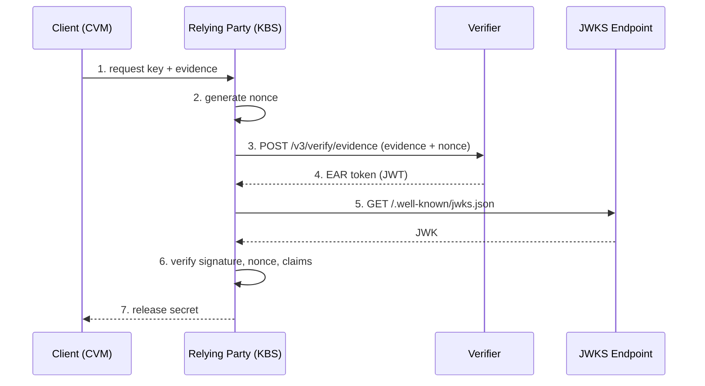
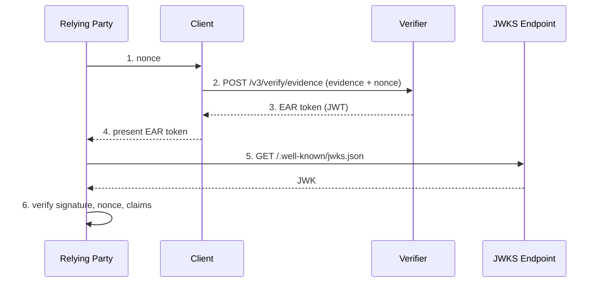

# enhancement-133: V3 Evidence Verification API with Multi-Evidence, Policy Binding, and Signed Results

<!-- toc -->
- [Release Signoff Checklist](#release-signoff-checklist)
- [Summary](#summary)
- [Motivation](#motivation)
  - [Goals](#goals)
  - [Non-Goals](#non-goals)
- [Proposal](#proposal)
  - [User Stories](#user-stories)
  - [Notes/Constraints/Caveats](#notesconstraintscaveats)
  - [Risks and Mitigations](#risks-and-mitigations)
- [Security Considerations](#security-considerations)
  - [Trust Model for One-Shot Verification](#trust-model-for-one-shot-verification)
  - [Evidence Verification Endpoint: Intentionally Unauthenticated](#evidence-verification-endpoint-intentionally-unauthenticated)
  - [Inline Policy Name Collision: Always Rejected](#inline-policy-name-collision-always-rejected)
  - [Evidence Replay and Nonce Binding](#evidence-replay-and-nonce-binding)
  - [JWT Signing Key Compromise Recovery](#jwt-signing-key-compromise-recovery)
  - [Cryptographic Algorithm Policy](#cryptographic-algorithm-policy)
  - [EAR Token as Bearer Token](#ear-token-as-bearer-token)
  - [Audit Logging](#audit-logging)
- [Design Details](#design-details)
  - [Implementation Phases](#implementation-phases)
  - [Phase 1: Signed Attestation Results (MVP)](#phase-1-signed-attestation-results-mvp)
  - [Phase 2: Response Quality and TEE Policy](#phase-2-response-quality-and-tee-policy)
  - [Phase 3: Multi-Evidence and Policy Binding](#phase-3-multi-evidence-and-policy-binding)
  - [Content Negotiation](#content-negotiation)
  - [Response Builder Architecture](#response-builder-architecture)
  - [Evidence Type Extensibility](#evidence-type-extensibility)
  - [Keylime EAR Profile (Future Work)](#keylime-ear-profile-future-work)
  - [Phase 4: Deferred Future Work](#phase-4-deferred-future-work)
  - [Configuration Options](#configuration-options)
  - [Policy Identity and Audit Traceability](#policy-identity-and-audit-traceability)
  - [EAR Format and IETF Alignment](#ear-format-and-ietf-alignment)
  - [Test Plan](#test-plan)
  - [Upgrade / Downgrade Strategy](#upgrade--downgrade-strategy)
  - [Dependency Requirements](#dependency-requirements)
- [Prior Art](#prior-art)
- [Drawbacks](#drawbacks)
- [Alternatives](#alternatives)
- [Infrastructure Needed (optional)](#infrastructure-needed-optional)
<!-- /toc -->

## Release Signoff Checklist

- [ ] Enhancement issue in release milestone, which links to pull request in [keylime/enhancements]
- [ ] Core members have approved the issue with the label `implementable`
- [ ] Design details are appropriately documented
- [ ] Test plan is in place
- [ ] User-facing documentation has been created in [keylime/keylime-docs]

## Summary

This enhancement redesigns the one-shot evidence verification endpoint for
API v3 to support EAR-formatted signed attestation results (JWT
serialization), multiple evidences in a single request, explicit
evidence-policy binding via a separate evaluations structure, named policy
references, and new policy types (TEE/SNP, TPM profiles).

The work is structured in four implementation phases, each delivering
independent value:

1. **Phase 1 (MVP)**: EAR-formatted signed attestation results (JWT
   serialization) with content negotiation (RFC 9782), JWKS endpoint,
   and `evidences`/`evaluations` arrays on the new v3 endpoint.
   Tokens are always issued (pass and fail). The signing key is
   auto-generated if not configured. This is the minimum viable product
   — it enables third-party verification (e.g., KBS integration) with a
   forward-compatible request schema.

2. **Phase 2**: Response quality improvements (trustworthiness vector,
   nested claims schema) and the TEE/SNP policy type with trust anchor
   validation. Policy identity (UUID + revision) on CRUD endpoints.

3. **Phase 3**: Multi-evidence request model, evaluations join table,
   named policy references, TPM policy profiles with sub-policy
   composition, and batch verification.

4. **Phase 4** (deferred): Multi-variant policy profiles, Rego/OPA
   policy engine, CWT serialization, CoRIM.

The response and JWT schemas are designed for forward compatibility: all
fields are present from Phase 1, with `null` or default values for
features not yet active. The signed attestation result follows the EAR
(EAT Attestation Results, draft-ietf-rats-ear) format with a `submods`
map from Phase 1 (single-entry in Phase 1, multi-entry from Phase 3
onward), ensuring a stable token schema across all phases. The EAR
token is always issued when evaluation completes (both pass and fail
outcomes per the EAR specification), and is never issued when an
infrastructure error prevents meaningful evaluation. The response
format is negotiated via the HTTP `Accept` header: `application/vnd.api+json`
for JSON:API (default) or `application/eat+jwt` for a raw JWT
(RFC 9782).

The request and response payloads use
[JSON:API](https://jsonapi.org/) format, consistent with the other v3
endpoints in the verifier.

## Motivation

The current v2 evidence verification endpoint (`POST /v2/verify/evidence`)
accepts a single evidence block with a single type (TPM or TEE) and inline
policies. This has several limitations:

1. **Unsigned results**: Attestation results are plain JSON — third parties
   (e.g., Key Broker Services) cannot independently verify that attestation
   succeeded without trusting the transport or the caller. This is the most
   critical gap, as it blocks the primary use case for one-shot attestation:
   presenting a verifiable proof of attestation to relying parties.

2. **No multi-evidence support**: Verifying both TPM and TEE evidence for
   the same agent requires two separate API calls. There is no way to
   express that both must pass for attestation to succeed.

3. **No batch verification**: Verifying multiple agents' evidence requires
   sequential requests. CI/CD pipelines testing policy changes against
   multiple hosts must make N separate calls.

4. **No named policy references**: Policies must be sent inline with every
   request. There is no way to reference policies already registered in
   the verifier, despite runtime and MB policy CRUD endpoints already existing
   in v3.

5. **No TEE policy concept**: TEE (SNP) verification has no policy — it
   only checks the VCEK signature (fetched live from AMD KDS over HTTPS)
   without validating the ARK/ASK certificate chain or comparing claims
   against expected reference values.

6. **No extensibility path**: The hardcoded per-type evaluation logic
   leaves no room for future policy engines (e.g., Rego/OPA) or
   cross-evidence evaluation.

### Goals

1. Produce a signed attestation result (JWT) for every completed
   evaluation (pass and fail), verifiable by third parties using a JWKS
   endpoint. Support content negotiation via `Accept` header (RFC 9782)
   for JSON:API or raw JWT responses. **(Phase 1 MVP)**

2. Produce attestation results in EAR (EAT Attestation Results,
   draft-ietf-rats-ear) format with JWT serialization, ensuring
   interoperability with the IETF RATS ecosystem. **(Phase 1 MVP)**

3. Introduce a TEE/SNP policy type with trust anchor certificates and
   expected reference values. **(Phase 2)**

4. Support multiple evidences of any supported type in a single API
   request. **(Phase 3)**

5. Support explicit evidence-policy binding via a separate evaluations
   structure, enabling one-to-many, many-to-one, and many-to-many
   relationships between evidences and policies. **(Phase 3)**

6. Support referencing pre-registered named policies in evaluation
   bindings, in addition to inline policy definitions. **(Phase 3)**

7. Introduce a TPM policy profile model that composes existing IMA
   policies and MB reference states by reference, keeping existing
   CRUD endpoints and tooling intact. **(Phase 3)**

8. Design the policy type system to be extensible to future policy
   engines (e.g., Rego/OPA) and future TEE types (Intel TDX, ARM CCA)
   without breaking API changes.

### Non-Goals

1. **Rego/OPA policy engine**: Identified as a future extension point but
   not implemented in this proposal.

2. **CWT serialization and CoRIM**: CWT (CBOR Web Token) serialization
   and CoRIM reference measurement format are out of scope. The initial
   implementation uses EAR with JWT serialization.

3. **Continuous attestation changes**: This proposal does not modify the
   verifier-driven continuous attestation model or the agent enrollment flow.
   Adding support for TEE evidence in the continuous attestation model is out of
   scope. The evidence verification endpoint is not used by the continuous
   attestation model. The policy management endpoints are shared between both
   models.

4. **v2 API changes**: The v2 evidence verification endpoint remains
   unchanged.

5. **Full policy versioning**: Named policies are mutable. Full version
   history, immutable snapshots, rollback, or diff between versions is
   out of scope. However, each policy carries a UUID (assigned on
   creation) and a revision counter (incremented on each update) for
   audit traceability — see
   [Policy Identity and Audit Traceability](#policy-identity-and-audit-traceability).

6. **Rate limiting or request quotas**: Not addressed in this proposal.

7. **Per-evaluation signed results**: The EAR token covers all
   evaluations in the request. Per-evaluation tokens for partial-pass
   scenarios are deferred (see [Drawbacks](#drawbacks)).

8. **Multi-variant policy profiles**: Support for multiple valid
   configurations within a single policy profile (for heterogeneous
   fleets, rolling updates, and live migration across platform
   generations) is deferred to a follow-up enhancement.

## Proposal

The v3 evidence verification endpoint (`POST /v3/verify/evidence`) is
enhanced incrementally across three implementation phases, each building
on the previous one while delivering independent value.

**Phase 1 (MVP)** creates the v3 evidence verification endpoint with
`evidences`/`evaluations` arrays in the request, a JSON:API response
schema, EAR-formatted signed attestation results (JWT serialization),
content negotiation via `Accept` header (RFC 9782), and a JWKS endpoint.
The request uses the full `evidences` and `evaluations` structure from
Phase 1, so Phase 3 adds no structural changes — only multiple elements.
The `nonce` field (always required) populates `eat_nonce` in the EAR
token. The EAR token is always issued when evaluation completes (both
pass and fail). The response schema is designed for forward compatibility
— all fields that later phases will populate are present from Phase 1,
using `null` or default values where the feature is not yet active. This
immediately enables the primary use case: presenting a verifiable
attestation proof to third parties such as Key Broker Services.

**Phase 2** enriches the response with AR4SI trustworthiness vectors
and nested claims, introduces the TEE/SNP policy type with trust anchor
validation, and adds policy identity (UUID + revision) to all CRUD
endpoints.

**Phase 3** redesigns the request to accept multiple evidences with
explicit evidence-policy binding via an evaluations join table. It
introduces named policy references, TPM policy profiles that compose
sub-policies by reference, and batch verification.

Each phase is independently deployable and backward-compatible with the
previous one. The signed attestation result follows the EAR format from
Phase 1, using a `submods` map (single-entry in Phase 1). Phase 3's
multi-evidence support adds more entries to the map without changing
the token schema.

### User Stories

#### Story 1: Third-party enrollment with signed proof (Phase 1)

A third-party device management system enrolls new devices. During
enrollment, it collects the device's TPM evidence, submits it to a
Keylime verifier, and receives a signed EAR token (JWT). The token is
forwarded to an independent enrollment authority that verifies the
signature using the verifier's JWKS endpoint and proceeds with device
provisioning — without needing direct access to the Keylime verifier.

#### Story 2: Key Broker Service integration (Phase 1)

A confidential computing platform runs SEV-SNP virtual machines with
SVSM-backed vTPMs. A Key Broker Service (e.g., Trustee KBS) holds disk
decryption keys. The KBS has a Keylime attestation plugin that uses the
`/v3/verify/evidence` endpoint as a backend attestation service.

During the KBS attestation protocol handshake, the confidential VM's
client (e.g., `clevis-pin-trustee`) sends its TEE evidence to the KBS.
The KBS plugin generates a nonce, submits the evidence to the Keylime
verifier with the nonce, and receives a signed EAR token (JWT). The KBS
verifies the token signature using the verifier's JWKS endpoint, checks
the nonce it generated, inspects the claims (including `ear_status`), and
releases the decryption key only if the attestation passed. The
confidential VM's client never communicates with the Keylime verifier
directly.

#### Story 3: Multi-evidence attestation for confidential VMs (Phase 3)

A confidential computing platform operator runs VMs with both a vTPM and
SEV-SNP protection. Before releasing secrets to a VM, the KBS attestation
plugin submits both the TPM quote and the SNP attestation report to the
Keylime verifier in a single request, each evaluated against its
respective policy. The signed EAR token covers both evaluations. The KBS
verifies it and releases the decryption key only if both evidence types
passed.

#### Story 4: Batch policy testing in CI/CD (Phase 3)

A system administrator maintains Keylime policies for a fleet of 50
servers. Before deploying a policy update, the CI pipeline collects
attestation evidence from a representative sample and submits all
evidences in a single batch request against the candidate policy. The
per-evaluation results show which hosts would pass or fail under the new
policy, enabling validation before rollout.

### Notes/Constraints/Caveats

- As with the v2 endpoint, the one-shot verification model does not
  establish trust in the origin of the evidence. The verifier evaluates
  whether the evidence passes the given policy, but cannot vouch for
  whether the evidence was collected from a trusted source. This
  distinction must be documented clearly.

- The TEE/SNP policy type is initially limited to AMD SEV-SNP. Support
  for Intel TDX, ARM CCA, or other TEE types can be added as new policy
  types and namespaces following the same pattern (see
  [Evidence Type and Policy Namespace Compatibility](#evidence-type-and-policy-namespace-compatibility)).

- The nonce in the evidence blocks and the nonce in the EAR token serve
  different purposes (see [Nonce Semantics](#nonce-semantics)).

- The claims schema in the v3 response is a **redesign** from the
  existing internal representation. The current `sev_snp_claims()`
  function uses flat keys (e.g., `reported_tcb_bootloader`,
  `policy_debug_allowed`). The v3 API uses nested objects (e.g.,
  `tcb.bootloader`, `guest_policy.debug_allowed`) for readability,
  extensibility, and alignment with EAR claim structure. A thin mapping
  layer translates internal representations to the v3 claims schema and
  to EAR token claims.

### Risks and Mitigations

1. **Key management complexity**: Administrators must distribute public
   keys to relying parties.
   - *Mitigation*: The verifier auto-generates a signing key at startup
     if none is configured (like TLS certificates). The JWKS endpoint
     automates public key distribution. Operators can override with
     their own key for production deployments. Clear operational
     documentation will cover key rotation procedures.

2. **EAR token claim structure**: The EAR claim schema may not meet
   the needs of all consuming services (e.g., KBS, custom policy engines).
   - *Mitigation*: Claims follow the EAR (EAT Attestation Results) format
     from Phase 1, ensuring interoperability with the RATS ecosystem.
     Keylime-specific extensions use the `keylime_` prefix. Gather early
     feedback from KBS integration work.

3. **Token replay and evidence replay**: A valid JWT could be presented
   after the attested system's state has changed. Additionally,
   previously captured evidence could be submitted with a new request
   nonce to obtain a fresh token.
   - *Mitigation*: JWT includes expiration (`exp`), not-before (`nbf`),
     a unique token ID (`jti`), and a caller-provided nonce (`eat_nonce`).
     Relying parties enforce freshness by requiring a nonce they
     generated. To prevent evidence replay, relying parties SHOULD also
     control the evidence nonce — see
     [Evidence Replay and Nonce Binding](#evidence-replay-and-nonce-binding)
     in Security Considerations.

4. **TEE trust anchor management**: Operators must obtain and maintain
   AMD ARK/ASK certificates for their processor families.
   - *Mitigation*: Provide tooling or documentation to fetch current
     certificates from AMD KDS for initial setup. The verifier validates
     that ARK certificates match known AMD root certificate fingerprints
     during policy creation.

5. **Policy name collisions**: An inline policy name could collide with a
   registered policy name.
   - *Mitigation*: Inline policy names that collide with a registered
     policy name in the same namespace are rejected with HTTP 400. This
     is a hard rule with no override — see
     [Inline Policy Name Collision: Always Rejected](#inline-policy-name-collision-always-rejected)
     in Security Considerations.

6. **JWT signing key compromise**: If the JWT signing private key is
   compromised, an attacker could forge EAR tokens.
   - *Mitigation*: Key compromise recovery procedure documented in
     [JWT Signing Key Compromise Recovery](#jwt-signing-key-compromise-recovery).
     Short token lifetimes (`jwt_expiration_seconds`, default 300s)
     limit the window of forged tokens. HSM integration recommended for
     high-security deployments.

## Security Considerations

This section documents the trust model, security boundaries, and
security-critical design decisions for the V3 evidence verification API.

### Trust Model for One-Shot Verification

The one-shot evidence verification endpoint is a **verification oracle**:
it evaluates whether submitted evidence satisfies a given policy and
returns a signed attestation result. Understanding what this proves — and
what it does not — is critical.

**What the EAR token proves:**

- The evidence was evaluated against a specific, identified policy by the
  issuing verifier.
- The evidence satisfied that policy at the time of evaluation.
- The token was produced by the verifier identified in the `iss` claim
  (verifiable via the JWKS endpoint).
- The token is fresh relative to the caller's nonce (via `eat_nonce`).

**What the EAR token does NOT prove:**

- That the evidence originated from a trusted or specific source. The
  verifier evaluates evidence, not the environment that produced it.
- That the attested system is currently trustworthy. System state may
  change between evidence collection and token presentation
  (time-of-verification vs. time-of-use gap).
- That the evidence has not been previously used. Evidence nonces are
  controlled by the evidence collector, not the verifier (see
  [Evidence Replay and Nonce Binding](#evidence-replay-and-nonce-binding)).

In the IETF RATS architecture (RFC 9334), the verifier produces
attestation results, but the **relying party** makes the trust decision.
The relying party is responsible for determining whether the EAR token's
contents — the policy used, the claims reported, and the freshness
guarantees — meet its authorization requirements.

### Evidence Verification Endpoint: Intentionally Unauthenticated

The `POST /v3/verify/evidence` endpoint does not require client
authentication (mTLS or otherwise). This is an intentional design
decision, not an oversight.

**Rationale:** The security of the attestation flow does not depend on
restricting who calls the verification endpoint. It depends on the
relying party correctly validating the EAR token. A relying party MUST:

1. **Verify the JWT signature** using the verifier's public key from the
   JWKS endpoint.
2. **Check `eat_nonce`** matches the nonce the relying party generated,
   proving the token was produced for this specific request.
3. **Inspect `ear_appraisal_policy_ids`** to confirm the expected policy
   was used. For registered policies, this includes the policy UUID URN
   (e.g., `urn:uuid:...#revision`), enabling precise identification.
4. **Inspect `ear_attester_claims`** to confirm the evidence claims
   (measurements, TCB versions, PCR values) satisfy the relying party's
   own requirements.
5. **Check `keylime_policy_source`** to confirm whether an inline or
   registered policy was used, if relevant to the relying party's trust
   model.

If the relying party performs these checks, an attacker calling the
endpoint with arbitrary evidence or a different policy gains nothing —
the resulting token would not satisfy the relying party's requirements.
Inline policy name impersonation is prevented by the collision rejection
rule (see below).

The JWKS endpoint (`GET /.well-known/jwks.json`) is also intentionally
unauthenticated — it serves public key material.

Policy CRUD endpoints (`/v3/policies/*`, `/v3/refstates/*`) remain
authenticated via mTLS, consistent with existing Keylime endpoints.

Denial-of-service mitigation for the unauthenticated endpoint is an
operational concern addressed by request size limits, concurrency limits,
and external rate limiting (out of scope for this proposal).

### Inline Policy Name Collision: Always Rejected

If an inline policy name matches a registered policy name in the same
namespace, the verifier returns HTTP 400 with a descriptive error. This
is a hard rule with no configuration override.

**Rationale:** Allowing inline policies to shadow registered policies
creates a policy confusion attack vector. An attacker could submit an
inline policy with the same name as a production policy but with
permissive rules, and the resulting EAR token would be difficult for the
relying party to distinguish from one produced with the genuine
registered policy.

By rejecting name collisions, the verifier guarantees that a policy name
in `ear_appraisal_policy_ids` unambiguously identifies the policy used.

For auditability, the EAR token includes `keylime_policy_source`
(`"inline"` or `"registered"`) per submod. For registered policies,
`ear_appraisal_policy_ids` also includes the policy UUID URN; for inline
policies the UUID URN is absent.

### Evidence Replay and Nonce Binding

The two-nonce design (evidence nonce and request nonce) is architecturally
sound but introduces an evidence replay risk that relying parties must
understand.

**Evidence nonces** (per-evidence, in `data.nonce`) prove that the
evidence was generated for a specific verification request — they bind
the evidence to the evidence collector's intent.

**Request nonces** (top-level `nonce`, mapped to `eat_nonce`) prove that
the EAR token was generated for a specific relying party request — they
bind the token to the relying party's intent.

These nonces are intentionally independent: evidence may be collected at
a different time than the token is requested, and in batch scenarios
(Phase 3) each evidence block may have a different evidence nonce.

**The risk:** If the relying party only controls the request nonce but not
the evidence nonce, previously captured evidence (with its original
evidence nonce) can be submitted in a new verification request with a
fresh request nonce. The verifier validates the evidence against its
original evidence nonce (which matches), and produces a new EAR token
with the fresh request nonce.

**Security guidance:** Relying parties SHOULD generate and control both
the request nonce AND the evidence nonce. One approach is to derive the
evidence nonce from the request nonce (e.g., by having the relying party
send the nonce to the agent, which uses it for evidence collection). This
binds evidence freshness to the token request and prevents replay.

An optional `nonce_binding` mode — where the verifier validates that the
evidence nonce is derived from the request nonce — is identified as
future work.

### JWT Signing Key Compromise Recovery

Key compromise requires a different procedure than normal key rotation.
Normal rotation has a transition period where both old and new keys are
in the JWKS. Key compromise requires immediate removal.

**Key compromise recovery procedure:**

1. **Immediately remove** the compromised key from the JWKS endpoint.
   Do not wait for a transition period.
2. **Generate a new signing key** and configure the verifier to use it.
3. All tokens previously signed with the compromised `kid` become
   unverifiable — relying parties that refresh the JWKS will no longer
   find the compromised key.
4. **Notify relying parties** to refresh their JWKS cache immediately.
   Relying parties SHOULD configure a maximum JWKS cache TTL of
   5 minutes to limit exposure in compromise scenarios.

The EAR token includes a `nbf` (not-before) claim set to the token's
issuance time. This enables time-bounded key validity if needed during
compromise recovery.

For high-security deployments, storing JWT signing keys in a Hardware
Security Module (HSM) is recommended to reduce the risk of key
extraction.

### Cryptographic Algorithm Policy

The verifier enforces an algorithm denylist for JWT signing:

| **Denied** | `none`, `HS256`, `HS384`, `HS512` |
|---|---|
| **Accepted** | Any asymmetric algorithm supported by jwcrypto and compatible with the configured signing key |

The verifier MUST reject a `jwt_signing_algorithm` configuration value
that appears on the denylist. Additionally, the verifier validates at
startup that the configured algorithm is (a) supported by the JWT
library in use and (b) when an operator-provided key is configured,
compatible with the key type. When auto-generating a key, the verifier
generates a key type appropriate for the configured algorithm.

The denylist prevents algorithm confusion attacks where an attacker
crafts a token with a symmetric algorithm (e.g., `HS256`) and signs it
using the public key as the HMAC secret. The `none` algorithm disables
signing entirely and MUST always be rejected. Asymmetric algorithms —
including ECDSA (`ES*`), EdDSA, RSA (`RS*`, `PS*`), and future
post-quantum algorithms — are accepted because they are not vulnerable
to this class of attack.

This denylist approach ensures crypto agility: when new asymmetric
algorithms receive jwcrypto support, they are accepted automatically
without code changes. This aligns with the design principle from the
[Dual Certification and Crypto Agility Roadmap](docs/design/dual-certification-pqc-roadmap.md):
*PQC support is not a special feature — it is a natural consequence of
proper crypto agility.*

**Post-quantum algorithms (ML-DSA):** ML-DSA-44, ML-DSA-65, and
ML-DSA-87 (FIPS 204) are target algorithms for JWT signing. JOSE
algorithm identifiers for ML-DSA are being standardized in
`draft-ietf-jose-pqc`. The `cryptography` Python library (v44.0.0+)
includes experimental ML-DSA key support, and OpenSSL 3.5+ provides the
underlying implementation. jwcrypto does not currently register ML-DSA
algorithm identifiers; when it does, the denylist approach means
no keylime code changes are needed. This is a desired target, not a
blocking requirement for the V3 API.

**Relying party guidance:** Configure JWT verification libraries to
accept only asymmetric algorithms matching the `alg` field in the JWKS
key. Do not allow the JWT header's `alg` claim to override the expected
algorithm.

### EAR Token as Bearer Token

The EAR token is a bearer token — any entity that possesses it can
present it to a relying party. The token does not bind to the identity
of the entity that requested it (no `sub` or `cnf` claims).

Token misuse is mitigated by:

- **Nonce freshness**: The relying party checks that `eat_nonce` matches
  the nonce it generated, proving the token was produced in response to
  its specific request.
- **Token lifetime**: The `exp` claim limits the window during which a
  stolen token can be used.
- **Unique token ID**: Each EAR token includes a `jti` (JWT ID) claim —
  a UUID generated per token — enabling audit correlation and allowing
  relying parties to detect duplicate token presentations.

Adding `sub` (subject) and `cnf` (confirmation/proof-of-possession key)
claims is identified as future work.

### Audit Logging

The verifier SHOULD log the following security-relevant events:

| Event | Log fields |
|---|---|
| EAR token issuance (success) | Timestamp, caller identity (if mTLS), policy used, evidence type, `jti` |
| EAR token issuance failure | Timestamp, caller identity, failure reason |
| Verification failure | Timestamp, evidence type, policy used, failure details |
| Policy CRUD operation | Timestamp, operator identity, policy name, operation (create/update/delete), UUID, revision |
| Key rotation | Timestamp, old `kid`, new `kid` |

The `jti` claim in EAR tokens enables correlation between verification
logs and tokens presented to relying parties.

## Design Details

### Implementation Phases

| Phase | Scope | Key Deliverables | Dependencies |
|---|---|---|---|
| **1 (MVP)** | V3 endpoint + signed attestation results | V3 evidence endpoint (JSON:API request with `evidences`/`evaluations` arrays, JSON:API response with `results` array, three-valued `status`), EAR token (JWT, always issued for pass and fail), content negotiation (Accept header, RFC 9782), signing key auto-generation, JWKS endpoint, request nonce, nested claims | — |
| **2** | Response quality + TEE policy | Trustworthiness vector, TEE/SNP policy CRUD, TEE/SNP claims schema, policy UUID/revision | Phase 1 |
| **3** | Multi-evidence + policy binding | Multiple evidences/evaluations per request, inline `policies` array, named policy references, TPM policy profiles | Phase 2 |
| **4** | Future work (deferred) | Multi-variant policy profiles, Rego/OPA, CWT serialization (`application/eat+cwt`), CoRIM, Keylime EAR profile URI | Phase 3 |

Each phase is a separate PR or set of PRs. Phases are backward-compatible
— Phase 1 clients continue to work unchanged as Phase 2 and 3 are
deployed.

### Phase 1: Signed Attestation Results (MVP)

Phase 1 creates the v3 evidence verification endpoint with both request
and response schemas designed for forward compatibility with later
phases. The request uses the `evidences` array and `evaluations` join
table from Phase 1 (single-element arrays), so Phase 3 adds no
structural request changes — only multiple elements. The response is
structured to:

- Use JSON:API format (consistent with other v3 endpoints).
- Wrap evaluation output in a `results` array (single-element in Phase 1,
  multi-element from Phase 3 onward).
- Replace the `valid` boolean with a three-valued `status` field
  (`"pass"`, `"fail"`, `"error"`).
- Include all fields that later phases will populate, using `null` or
  default values where the feature is not yet active (see
  [Phase 1 field availability](#phase-1-field-availability) below).

This upfront investment in both request and response structure means
Phase 2 and Phase 3 can add functionality without changing schemas —
they populate fields that already exist and allow additional array
elements.

The primary new functionality is EAR-formatted signed attestation
results. The response always includes a signed EAR token (JWT
serialization) when evaluation completes — for both pass (`ear_status:
"affirming"`) and fail (`ear_status: "contraindicated"`) outcomes, per
the EAR specification (draft-ietf-rats-ear-04). The token is only
withheld when an infrastructure error prevents meaningful evaluation.
Third parties verify the token using the new JWKS endpoint, and inspect
`ear_status` to determine the attestation outcome. The token follows
the EAR (EAT Attestation Results, draft-ietf-rats-ear) format, ensuring
interoperability with the IETF RATS ecosystem.

The response format is selected via the HTTP `Accept` header using
RFC 9782 media types: `application/vnd.api+json` (default) returns the
JSON:API response with the token embedded; `application/eat+jwt`
returns the raw JWT as the response body.

The signing key is auto-generated at startup if not configured by the
operator, following the same pattern as TLS certificates in
`/var/lib/keylime/cv_ca/`. This ensures the signing infrastructure is
always available with zero configuration for development and testing,
while production deployments can override with operator-managed keys.

#### Phase 1 request changes

The request schema uses the `evidences` array and `evaluations` join
table from Phase 1. This means Phase 3 adds no request format changes
— it only enables multiple elements in these arrays plus the `policies`
array for inline policies. The response format is selected via the
`Accept` header (see [Content Negotiation](#content-negotiation)).

| Field | Required | Description |
|---|---|---|
| `nonce` | Yes | Caller-generated nonce for token freshness. base64url-encoded opaque bytes, minimum 16 bytes (128 bits), maximum 64 bytes (per EAR's `eat_nonce` constraint). Included in the EAR token as `eat_nonce` unchanged. |
| `evidences` | Yes | Array of evidence blocks to verify (single-element in Phase 1). |
| `evaluations` | Yes | Array of evidence-policy bindings. Each entry maps one evidence to one policy. |

The `nonce` field is always required. It populates the `eat_nonce`
claim in the EAR token, proving to the relying party that the token was
produced for this specific request. The nonce must be base64url-encoded
(RFC 4648 §5). Clients using standard base64 (e.g., KBS) must convert
to base64url before submitting. The verifier rejects non-base64url
nonces with HTTP 400.

The EAR token is always produced when evaluation completes without
infrastructure error — there is no opt-in mechanism. The `Accept` header
controls the response format (JSON:API with embedded token, or raw JWT).

##### Evidence block fields (Phase 1)

| Field | Required | Description |
|---|---|---|
| `id` | Yes | Unique identifier within the request. Used by evaluations to reference this evidence. Must match `[a-zA-Z0-9_-]+`, max 128 characters. |
| `type` | Yes | Evidence type: `"tpm"` or `"tee"`. |
| `data` | Yes | Type-specific evidence data (same schema as v2 per type). |

##### Evaluation block fields (Phase 1)

| Field | Required | Description |
|---|---|---|
| `evidence` | Yes | ID of an evidence block in the `evidences` array. |
| `policy` | Yes | Qualified policy name: `"<namespace>:<name>"`. Use `"<namespace>:inline"` to reference the inline policy from the evidence data (v2 behavior). |

The `evaluations` array is **always required**, even for single-evidence
requests. This eliminates conditional parsing logic and ensures the
request format is stable across all phases.

#### Phase 1 request example

```json
{
  "data": {
    "type": "evidence-verification",
    "attributes": {
      "nonce": "Ks7rH2wQz9xY4bN1mP6dT3eF5gA8hJ0k",
      "evidences": [
        {
          "id": "default",
          "type": "tpm",
          "data": {
            "quote": "<base64>",
            "nonce": "<evidence-nonce>",
            "hash_alg": "sha256",
            "tpm_ek": "<PEM>",
            "tpm_ak": "<PEM>",
            "ima_measurement_list": "<ascii>",
            "mb_log": "<base64>"
          }
        }
      ],
      "evaluations": [
        { "evidence": "default", "policy": "tpm:inline" }
      ]
    }
  }
}
```

The `evidences` and `evaluations` arrays are new in Phase 1 (replacing
the previous flat `type`/`data`/`policy` fields). Evidence data within
each block matches the existing v2 evidence submission format. The
`nonce` is always required — it populates `eat_nonce` in the EAR
token. The `Accept` header (not shown) controls the response format.

When `policy` is `tpm:inline`, the evaluator uses policy data from the
evidence block's `data` field — `tpm_policy`, `runtime_policy`, and
`mb_log` as siblings of `quote` in the v2 evidence format. The evaluator
extracts these fields from the evidence data and uses them as the policy
for the evaluation, matching the v2 behavior.

#### Phase 1 response schema

```json
{
  "data": {
    "type": "evidence-verification-result",
    "attributes": {
      "results": [
        {
          "evidence": "default",
          "evidence_type": "tpm",
          "policy": "tpm:inline",
          "policy_source": "inline",
          "policy_uuid": null,
          "policy_revision": null,
          "resolved_sub_policies": null,
          "status": "pass",
          "trustworthiness": null,
          "claims": {
            "pcrs": { "0": "<hex>", "1": "<hex>" },
            "ima": { "entries_count": 1234, "violations": [] },
            "measured_boot": { "entries_count": 56 }
          },
          "failures": []
        }
      ],
      "attestation_result": "<signed-ear-jwt-string>"
    }
  }
}
```

The `results` array is always present (single-element in Phase 1). The
`attestation_result` field contains a signed EAR token (JWT) when
evaluation completes without infrastructure error — for both `status:
"pass"` (`ear_status: "affirming"`) and `status: "fail"` (`ear_status:
"contraindicated"`). It is `null` only when the evaluation has `status:
"error"` (infrastructure failure preventing meaningful evaluation).

When the client requests `Accept: application/eat+jwt`, the response
body is the raw JWT string (not wrapped in JSON:API). See
[Content Negotiation](#content-negotiation).

#### Phase 1 field availability

All response and JWT fields are present from Phase 1. Fields that are
populated in later phases carry null or default values until then:

| Field | Phase 1 value | Populated from |
|---|---|---|
| `evidence` | Caller-assigned ID from `evidences[].id` | Phase 1 |
| `evidence_type` | Evidence type (e.g., `"tpm"`, `"tee-snp"`) | Phase 1 |
| `policy` | Namespace-qualified name (e.g., `"tpm:inline"`) | Phase 1 |
| `policy_source` | `"inline"` (default) or `"registered"` (when `policy` field references an existing policy store) | Phase 1 |
| `policy_uuid` | `null` | Phase 2 |
| `policy_revision` | `null` | Phase 2 |
| `resolved_sub_policies` | `null` | Phase 3 |
| `status` | `"pass"`, `"fail"`, or `"error"` | Phase 1 |
| `trustworthiness` | `null` | Phase 2 |
| `claims` | Nested object (type-dependent) | Phase 1 |
| `failures` | Array of failure details | Phase 1 |

The evidence ID in the response corresponds to the `id` field from the
`evidences` array in the request. Callers assign their own IDs from
Phase 1 — `"default"` is a common convention for single-evidence
requests but has no special meaning.

Namespace-qualified policy names (e.g., `"tpm:inline"`) are used from
Phase 1 for consistency. Callers specify them explicitly in the
`evaluations` array.

The EAR token uses EAR-standard field names (`submods`, `ear_status`,
`ear_attester_claims`, `ear_appraisal_policy_ids`), while the JSON:API
response body uses independent human-friendly names (`results`, `status`,
`claims`, `policy`). The verifier produces both formats from the same
internal evaluation results.

#### Naming conventions

The API uses mixed casing intentionally — each identifier follows the
convention of its governing standard. The following table documents which
standard applies to each namespace:

| Namespace / Context | Convention | Standard | Examples |
|---|---|---|---|
| EAR token claims | `snake_case` | IETF EAR (draft-ietf-rats-ear) | `ear_status`, `eat_nonce`, `ear_trustworthiness_vector` |
| Keylime extension claims | `snake_case` | Keylime convention (`keylime_` prefix) | `keylime_evidence_type`, `keylime_policy_source`, `keylime_tee_pubkey` |
| AR4SI trust vector categories | `kebab-case` | IETF AR4SI (draft-ietf-rats-ar4si) | `instance-identity`, `runtime-opaque`, `file-system` |
| JSON:API resource types | `kebab-case` | JSON:API spec | `evidence-verification-result`, `tee-snp-policy` |
| Evidence/policy type strings | `kebab-case` | Keylime convention | `tee-snp`, `tee-tdx` |
| JSON:API response fields | `snake_case` | Keylime convention | `evidence_type`, `policy_source`, `policy_uuid` |
| Policy schema fields | `snake_case` | JSON convention | `ark_cert`, `vcek_source`, `chain_only` |

Implementors and consumers encountering mixed casing should consult this
table to determine the authoritative convention for a given context.
Keylime-defined identifiers (response fields, policy schema fields,
extension claims) consistently use `snake_case`. External standards
dictate the convention for their own namespaces.

#### Nested claims schema

Starting in Phase 1, claims use nested objects for readability and
extensibility. This is a redesign from the existing internal flat-key
representation (e.g., `reported_tcb_bootloader` becomes
`tcb.bootloader`). A thin mapping layer translates internal
representations to the v3 claims schema.

**TPM claims:**

```json
{
  "pcrs": { "0": "<hex>", "1": "<hex>", "10": "<hex>" },
  "ima": { "entries_count": 1234, "violations": [] },
  "measured_boot": { "entries_count": 56 }
}
```

Phase 2 defines the TEE/SNP claims schema (see
[Phase 2](#phase-2-response-quality-and-tee-policy)).

**Flat-to-nested mapping reference:** The internal `sev_snp_claims()`
function uses flat keys. The mapping to the nested v3 claims schema is:

| Internal flat key | Nested v3 path |
|---|---|
| `reported_tcb_bootloader` | `tcb.bootloader` |
| `reported_tcb_tee` | `tcb.tee` |
| `reported_tcb_snp` | `tcb.snp` |
| `reported_tcb_microcode` | `tcb.microcode` |
| `measurement` | `measurement` |
| `guest_svn` | `guest_svn` |
| `policy` | `guest_policy` (object with flag fields) |
| `platform_info` | `platform_info` (object with flag fields) |
| `report_id` | `report_id` |
| `chip_id` | `chip_id` |
| `report_data` | `evidence_binding.report_data` |
| `host_data` | `evidence_binding.host_data` |

#### JWT header

```json
{
  "alg": "ES256",
  "typ": "JWT",
  "kid": "<key-id>"
}
```

The `kid` identifies which signing key was used, enabling key rotation.

#### EAR token claims

The EAR token is issued whenever evaluation completes without
infrastructure error. This includes both pass and fail outcomes, per the
EAR specification (draft-ietf-rats-ear-04, which includes a
"contraindicated" failure example in Figure 3) and the RATS Architecture
(RFC 9334, which defines Attestation Results as conveying both positive
and negative outcomes). The token is only withheld when `status:
"error"` (infrastructure failure — no meaningful evaluation occurred).

##### Token issuance policy

| Evaluation outcome | `ear_status` | Token issued? |
|---|---|---|
| All pass | `affirming` | Yes |
| Any fail (no errors) | `contraindicated` | Yes |
| Any error (infrastructure) | — | No |
| Mixed fail + error | — | No (error prevents meaningful result) |

##### EAR token example (pass)

```json
{
  "eat_profile": "tag:ietf.org,2026:rats/ear#04",
  "iss": "<verifier-identifier-uri>",
  "iat": 1726000000,
  "nbf": 1726000000,
  "exp": 1726003600,
  "jti": "550e8400-e29b-41d4-a716-446655440000",
  "eat_nonce": "<base64url-encoded-request-nonce>",
  "ear_verifier_id": {
    "developer": "https://keylime.dev",
    "build": "keylime-verifier/<version>"
  },
  "ear_status": "affirming",
  "submods": {
    "default": {
      "ear_status": "affirming",
      "ear_appraisal_policy_ids": ["tpm:inline"],
      "ear_attester_claims": {
        "pcrs": { "0": "<hex>", "1": "<hex>" },
        "ima": { "entries_count": 1234, "violations": [] },
        "measured_boot": { "entries_count": 56 }
      },
      "keylime_evidence_type": "tpm",
      "keylime_policy_source": "inline"
    }
  }
}
```

##### EAR token example (fail — contraindicated)

When evaluation completes but evidence does not satisfy the policy, the
token carries `ear_status: "contraindicated"` and includes failure
details:

```json
{
  "eat_profile": "tag:ietf.org,2026:rats/ear#04",
  "iss": "<verifier-identifier-uri>",
  "iat": 1726000000,
  "nbf": 1726000000,
  "exp": 1726003600,
  "jti": "661f9500-f30c-52e5-b827-ff7766552222",
  "eat_nonce": "<base64url-encoded-request-nonce>",
  "ear_verifier_id": {
    "developer": "https://keylime.dev",
    "build": "keylime-verifier/<version>"
  },
  "ear_status": "contraindicated",
  "submods": {
    "default": {
      "ear_status": "contraindicated",
      "ear_appraisal_policy_ids": ["tpm:inline"],
      "ear_attester_claims": {
        "pcrs": { "0": "<hex>", "1": "<hex>" },
        "ima": { "entries_count": 1234, "violations": ["suspicious_binary"] },
        "measured_boot": { "entries_count": 56 }
      },
      "keylime_evidence_type": "tpm",
      "keylime_policy_source": "inline",
      "keylime_failures": [
        {
          "type": "tpm.ima_violation",
          "message": "IMA log entry violates runtime policy"
        }
      ]
    }
  }
}
```

Relying parties MUST check `ear_status` in the token to determine the
attestation outcome — a token's presence does not imply success.

The `submods` map contains a single entry in Phase 1 (keyed `"default"`).
This map-from-day-one design ensures the EAR token schema is stable
across phases — Phase 3 adds more entries to the map without changing
the structure. Relying parties parse the same EAR schema regardless of
which phase the verifier implements.

Each submod entry includes an explicit `ear_status` field — `"affirming"`
for pass and `"contraindicated"` for fail. This makes the token
self-describing and allows relying parties to validate their
expectations programmatically.

The `eat_nonce` in the EAR token is the **request-level nonce**, not the
per-evidence nonce (see [Nonce Semantics](#nonce-semantics)).

`ear_trustworthiness_vector` is absent in Phase 1 (EAR makes it
conditional). `keylime_policy_source` indicates `"inline"` when using
inline policies from the evidence data, or `"registered"` when the
`policy` field references an existing policy store (e.g., runtime
policies or MB refstates). Phase 2 adds `ear_trustworthiness_vector`
and policy UUID/revision in `ear_appraisal_policy_ids` — see
[Policy Identity and Audit Traceability](#policy-identity-and-audit-traceability).

#### JWT issuer identity

The `iss` claim is a **URI** configured via `jwt_issuer` or derived from
the verifier's TLS certificate SAN when `jwt_issuer` is empty (see
[Configuration Options](#configuration-options)). The URI scheme is not
prescribed — it accommodates different deployment models:

| Deployment | Example `jwt_issuer` |
|---|---|
| Single verifier | `https://verifier.example.com` |
| Auto-derived from TLS cert SAN | `https://verifier-host.example.com:8881` |
| Cluster (shared identity) | `https://verifier-cluster.example.com` |
| UUID-based | `urn:uuid:550e8400-e29b-41d4-a716-446655440000` |
| SPIFFE (future) | `spiffe://keylime.example.com/verifier/production` |

For horizontally scaled deployments, all verifier instances in a cluster
use the same `jwt_issuer` URI and share the same signing key. The signing
key distribution follows the same pattern as TLS certificate distribution,
which keylime already handles.

When SPIFFE/SPIRE integration is implemented, the verifier's SPIFFE ID
is automatically used as the `jwt_issuer` value via the SAN derivation
mechanism — X.509-SVIDs carry the SPIFFE ID as a URI SAN, which the
verifier extracts and uses directly. The SVID could also serve as the
JWT signing credential, eliminating separate key management. This is
compatible with the current URI-based design without changes.

#### EAR verifier identity

The `ear_verifier_id` claim identifies the verifier software per the EAR
specification. It contains:

- `developer`: Identifies the software project (default:
  `"https://keylime.dev"`). Configurable via `jwt_verifier_developer`.
- `build`: Identifies the software version (default: auto-detected from
  package version, e.g., `"keylime-verifier/1.2.3"`). Configurable via
  `jwt_verifier_build`.

Both `iss` (deployment instance identity) and `ear_verifier_id` (software
identity) are included in the EAR token. They serve different purposes:
`iss` identifies *which verifier instance* produced the result;
`ear_verifier_id` identifies *what software* produced it.

#### JWT configuration

The verifier configuration includes:

- `jwt_signing_key`: Path to the private key (PEM) for signing JWTs.
  When empty, a key is auto-generated using `jwt_signing_algorithm` and
  persisted to `/var/lib/keylime/signing/jwt_signing_key.pem`.
- `jwt_signing_algorithm`: Algorithm (default: `ES256`). Used for both
  operator-provided and auto-generated keys. Must not be on the
  algorithm denylist (`none`, `HS*`) and must be supported by the JWT
  library — see [Cryptographic Algorithm Policy](#cryptographic-algorithm-policy).
- `jwt_issuer`: Issuer identifier URI. When empty, derived from the TLS
  certificate's Subject Alternative Name (see below). The verifier fails
  to start if no issuer can be determined.
- `jwt_expiration_seconds`: Token lifetime (default: 300 seconds).
- `jwt_verifier_developer`: Developer identifier for `ear_verifier_id`
  (default: `"https://keylime.dev"`).
- `jwt_verifier_build`: Build identifier for `ear_verifier_id` (default:
  auto-detected from package version).

The EAR token includes the following standard JWT claims in addition to
EAR-specific claims:

- `jti`: A UUID v4 generated per token for audit correlation and replay
  detection.
- `nbf`: Not-before timestamp, set to the same value as `iat`. Enables
  time-bounded key validity during key compromise recovery.

#### Nonce Semantics

There are two distinct nonce contexts:

1. **Evidence nonces** (per-evidence, in `data.nonce`): Used for TPM
   quote freshness and TEE report freshness. These are between the
   evidence collector and the verifier — they prove the evidence was
   generated for this specific verification request.

2. **Request nonce** (top-level `nonce`, mapped to `eat_nonce` in the EAR
   token): Used for token freshness. Always required. This is between
   the caller (or relying party) and the verifier — it proves the token
   was generated for this specific request. The relying party generates
   this nonce and later checks the `eat_nonce` claim in the EAR token.

These are intentionally separate:

- Evidence nonces are type-specific (TPM quotes require a nonce in a
  specific format; SNP reports hash the nonce differently).
- The request nonce is application-level and opaque to the verifier — it
  is passed through to the EAR token as `eat_nonce` unchanged (the bytes
  are identical; the encoding is base64url in both request and token).
- In batch scenarios (Phase 3), each evidence block may have a different
  evidence nonce (collected at different times), but they all share the
  same request nonce.

##### Request nonce format

The request nonce must be:
- base64url-encoded opaque bytes
- Minimum 16 bytes (128 bits) decoded — stricter than RFC 9711's
  8-byte minimum, to prevent weak nonces
- Maximum 64 bytes decoded — per RFC 9711's upper bound
- Opaque — the verifier does not interpret the content, it passes the
  decoded bytes through to the EAR token's `eat_nonce` claim unchanged

##### Security guidance

Because evidence nonces and request nonces are independent, previously
captured evidence can be replayed with a fresh request nonce if the
relying party does not control the evidence nonce. See
[Evidence Replay and Nonce Binding](#evidence-replay-and-nonce-binding)
in Security Considerations for the full analysis and recommended
mitigations.

#### JWKS Endpoint

A new endpoint at `GET /.well-known/jwks.json` (domain root, not
versioned — keys serve all API versions) serves the verifier's public
signing key(s) in standard JWKS format
([RFC 7517](https://www.rfc-editor.org/rfc/rfc7517)).

The response includes the following headers:

- `Content-Type: application/jwk-set+json`
- `Cache-Control: max-age=300, public`
- `Access-Control-Allow-Origin: *` (public key material; CORS is
  permissive by design)

The JWKS endpoint serves public key material and does **not** require
client authentication. It is registered as a public route
(`requires_auth=False`) on the existing verifier HTTPS port, following
the same pattern as `/v3/sessions` (push-mode PoP authentication) and
`/v3/verify/evidence`. The verifier's TLS layer uses `CERT_OPTIONAL`
(set in `server.py`), so clients without a client certificate can still
connect over TLS and fetch the JWKS. The server presents its TLS
certificate, allowing clients to verify they are talking to the correct
verifier. No separate port or reverse proxy configuration is needed.

The evidence verification endpoint does not include CORS headers. It is
designed for server-to-server use (relying party → verifier).
Browser-based integrations should use a backend proxy.

The JWK format varies by key type. The following examples show common
configurations:

**ECDSA (ES256 / P-256)** — the default:

```json
{
  "keys": [
    {
      "kty": "EC",
      "crv": "P-256",
      "x": "<base64url>",
      "y": "<base64url>",
      "kid": "<key-id>",
      "use": "sig",
      "alg": "ES256"
    }
  ]
}
```

**EdDSA (Ed25519):**

```json
{
  "keys": [
    {
      "kty": "OKP",
      "crv": "Ed25519",
      "x": "<base64url>",
      "kid": "<key-id>",
      "use": "sig",
      "alg": "EdDSA"
    }
  ]
}
```

**ML-DSA (future, per `draft-ietf-jose-pqc`):**

```json
{
  "keys": [
    {
      "kty": "ML-DSA",
      "alg": "ML-DSA-65",
      "pub": "<base64url-encoded-public-key>",
      "kid": "<key-id>",
      "use": "sig"
    }
  ]
}
```

> **Note:** The ML-DSA JWK format follows `draft-ietf-jose-pqc`, which
> is still in progress. This example documents the target format for when
> JWT library support arrives. jwcrypto does not currently support
> ML-DSA key types.

##### Key rotation

Key rotation follows the standard JWKS pattern:

1. Administrator generates a new signing key and configures the verifier
   to use it.
2. The JWKS endpoint publishes both the old and new public keys.
3. New tokens are signed with the new key (`kid` in the JWT header
   identifies which key was used).
4. After a transition period (longer than `jwt_expiration_seconds`), the
   old key is removed from the JWKS.
5. Relying parties cache the JWKS and refresh when they encounter an
   unknown `kid`.

##### Air-gapped deployments

For environments where the relying party cannot reach the verifier's
JWKS endpoint, the JWKS can be exported as a static JSON file and
distributed out-of-band. A tool can be provided to fetch the current
JWKS from the verifier's endpoint and write it to a file for offline
use. The tool requires network access to the verifier at export time.
The resulting file is then transported to the relying party's
environment through an out-of-band mechanism (e.g., secure file
transfer, configuration management). The relying party uses this static
file instead of fetching from the JWKS endpoint.

Operators must re-export and redistribute the JWKS file after key
rotation to ensure the relying party has the current public keys.

##### Key compromise recovery

Key compromise requires a different procedure than normal rotation — the
compromised key must be removed immediately rather than kept during a
transition period. See
[JWT Signing Key Compromise Recovery](#jwt-signing-key-compromise-recovery)
in Security Considerations.

#### Content Negotiation

The response format is selected via the HTTP `Accept` header using
RFC 9782 (EAT Media Types) media types. The media type describes the
entire HTTP response body.

| Accept header | Content-Type | Response body | Phase |
|---|---|---|---|
| `application/vnd.api+json` (or absent / `*/*`) | `application/vnd.api+json` | JSON:API with `results`, `claims`, embedded `attestation_result` | 1 |
| `application/eat+jwt; eat_profile="tag:ietf.org,2026:rats/ear#04"` | `application/eat+jwt; eat_profile="..."` | Raw JWT string (EAR token) | 1 |
| `application/eat+cwt; eat_profile="tag:ietf.org,2026:rats/ear#04"` | `application/eat+cwt; eat_profile="..."` | Raw CWT bytes | 4 (deferred) |
| Unsupported media type or profile | — | HTTP 406 Not Acceptable | 1 |

**Semantics:**

- `application/eat+jwt` → response body IS the raw EAR token (JWT
  string). The client decodes the JWT directly.
- `application/vnd.api+json` → JSON:API response with the EAR token
  embedded in the `attestation_result` field.
- No `Accept` header or `*/*` → defaults to `application/vnd.api+json`.
- The `eat_profile` parameter is required on EAT media types.
  `application/eat+jwt` without `eat_profile` returns HTTP 406.
- The `eat_profile` value must match a supported profile. In Phase 1
  only `tag:ietf.org,2026:rats/ear#04` is supported. A profile mismatch
  returns HTTP 406.
- All responses include `Vary: Accept` (responsibility of the response
  builder — see Task 2.2).

**Error responses when the client requested raw token
(`application/eat+jwt`):**

When the client requests `application/eat+jwt`, error responses cannot
use JSON:API format (the client expects a JWT, not JSON). Instead,
errors use RFC 9457 Problem Details (`application/problem+json`):

- Evaluation pass or fail → HTTP 200 with raw JWT.
- Evaluation error (infrastructure failure, no token possible) →
  HTTP 502 with `Content-Type: application/problem+json`. HTTP 502 is
  used because the verifier acts as an intermediary to the attestation
  evaluation pipeline (TPM, KDS, certificate authorities); when that
  pipeline fails, the verifier is reporting an upstream failure.
- Request validation error → HTTP 400 with
  `Content-Type: application/problem+json`.
- Unsupported Accept → HTTP 406 with
  `Content-Type: application/problem+json`.

RFC 9457 Problem Details example:

```json
{
  "type": "urn:keylime:error:evaluation-error",
  "title": "Evaluation Error",
  "status": 502,
  "detail": "Infrastructure error prevented token issuance: AMD KDS unreachable"
}
```

JSON:API error format is used only when the client requested
`application/vnd.api+json` (or used the default).

#### Response Builder Architecture

The verifier produces multiple output formats from the same internal
evaluation results. The architecture separates evaluation from
serialization:

```
Evidence → Evaluation Pipeline → EvaluationResult[] (internal)
                                        │
                        ┌───────────────┼───────────────┐
                        ▼               ▼               ▼
                EAR Claims Builder   JSON:API Builder   Problem Details
                        │                                (error cases)
                ┌───────┴───────┐
                ▼               ▼
          JWT Serializer   CWT Serializer
                            (Phase 4)
```

Key abstractions:

1. **EvaluationResult** — internal representation: status (pass/fail/error),
   claims, failures, policy metadata, trust vector. This is the contract
   between the evaluation pipeline and all output paths. Defined as part
   of Task 2.1 (EAR Claims Builder), since it is the first task that
   produces and consumes this representation.
2. **EAR Claims Builder** — transforms EvaluationResult into an EAR claims
   dict. Builds claims for both `"affirming"` (pass) and
   `"contraindicated"` (fail) outcomes. The claims dict is
   format-agnostic — it can be serialized as JWT or CWT.
3. **Token Serializer** — transforms the claims dict into a signed JWT
   (or CWT in Phase 4).
4. **JSON:API Response Builder** — transforms EvaluationResult into a
   JSON:API response dict. Always calls the Claims Builder + Serializer
   to embed the `attestation_result`.

The endpoint controller selects the output path based on the negotiated
content type from the `Accept` header.

#### Evidence Type Extensibility

The verifier is designed so that adding support for a new evidence type
(e.g., Intel TDX, ARM CCA) requires minimal changes and does not break
existing functionality.

##### Evaluator registry

Each evidence type has an evaluator implementing the interface:
`evaluate(evidence_data, policy_data) → EvaluationResult`. The
evaluation dispatcher looks up the evaluator by evidence type and
policy namespace. The evaluator registry and dispatcher interface are
defined as part of Task 3.1 (Endpoint Skeleton), which owns the
dispatch logic. Adding a new evidence type requires:

1. Implement the evaluator.
2. Register it in the dispatcher.
3. Register a claims translator for the type.
4. Register trust vector categories for the type.
5. Add a row to the compatibility table.

No changes to the endpoint, request schema, response schema, or
existing evaluators are needed.

##### Unsupported evidence types

When an evidence block has an unknown `type` or TEE sub-type, the
evaluator dispatcher produces an evaluation-level `status: "error"` with
type `eval.unsupported_evidence_type`. The HTTP response is still 200
(the request itself is valid — the verifier simply cannot evaluate that
type). Other evaluations in the same request proceed normally.

##### Claims translation extensibility

Each evidence type registers its own claims translator — a function
that maps internal evaluation data to the nested claims schema. New
types add translators without modifying existing ones. Similarly, each
type registers its trust vector categories (which AR4SI categories
apply and how they map from evaluation results).

##### Configurable enabled types (nice-to-have, post-MVP)

A future configuration option `enabled_evidence_types` (default: all
registered types) could allow operators to restrict which evidence
types the verifier accepts. Disabled types would return
`eval.evidence_type_disabled`. This is not required for the MVP but
the evaluator registry design accommodates it naturally.

#### Keylime EAR Profile (Future Work)

A Keylime-specific EAR profile URI (`https://keylime.dev/profiles/ear/v1`)
is identified as nice-to-have future work. The profile would document:

- The `keylime_*` extension claims and their schemas.
- Per-evidence-type claims schemas and trust vector mappings.
- The failure type taxonomy.
- Keylime-specific semantics beyond the base EAR specification.

In the EAR token, the standard `eat_profile` claim would remain
`tag:ietf.org,2026:rats/ear#04` for EAR compliance. The Keylime profile
URI would be added as a second `eat_profile` value (EAT RFC 9711 allows
multiple profiles) or as a `keylime_profile` extension claim.

This is a documentation effort independent of code changes. A future
enhancement could pursue IETF registration of the Keylime EAR profile.

#### Verification workflows

The evidence verification endpoint supports two integration models,
corresponding to the **background-check** and **passport** models in the
IETF RATS architecture (RFC 9334). Both models are fully supported — the
endpoint does not prescribe who calls it.

##### Background-check model (primary — KBS integration)

In this model, the relying party calls the verifier directly. The client
(e.g., a confidential VM) never communicates with the Keylime verifier.
This is the model used by Key Broker Services such as
[Trustee KBS](https://github.com/confidential-containers/trustee), where
the KBS has an attestation service plugin that uses the Keylime verifier
as a backend.



1. **Client** sends evidence to the **relying party** (e.g., during the
   KBS attestation protocol handshake).
2. **Relying party** generates a nonce, submits the evidence to
   `POST /v3/verify/evidence` with the nonce.
3. **Verifier** evaluates the evidence and returns the EAR token (JWT).
4. **Relying party** verifies the EAR token:
   a. Fetches the verifier's public key from `GET /.well-known/jwks.json`
      (cached, refreshed on `kid` miss).
   b. Validates the signature using the matching `kid`.
   c. Checks `ear_status` — `"affirming"` means pass,
      `"contraindicated"` means fail.
   d. Checks `exp` for token lifetime.
   e. Checks `eat_nonce` matches the nonce it generated.
   f. Inspects `submods` to confirm expected evidence types and policies
      were evaluated.
   g. Makes authorization decision (e.g., release decryption key).

This model is preferred for KBS integration because:

- The client does not need to know about Keylime or its API.
- The relying party controls both the request nonce and the evidence
  submission, eliminating the evidence replay risk described in
  [Evidence Replay and Nonce Binding](#evidence-replay-and-nonce-binding).
- It matches the existing Trustee KBS attestation plugin architecture,
  where the KBS calls a backend attestation service on behalf of the
  client.

##### Passport model (alternative — direct client integration)

In this model, the client calls the verifier directly and presents the
resulting EAR token to the relying party. The relying party never
communicates with the Keylime verifier (except to fetch the JWKS for
signature verification).



1. **Relying party** generates a nonce and sends it to the **client**.
2. **Client** collects evidence, submits it to `POST /v3/verify/evidence`
   with the nonce.
3. **Verifier** evaluates the evidence and returns the EAR token (JWT).
4. **Client** presents the EAR token to the **relying party**.
5. **Relying party** verifies the EAR token (same steps as above).

This model is useful when:

- The client needs a portable, self-contained attestation proof that can
  be presented to multiple relying parties.
- The relying party cannot or should not have network access to the
  Keylime verifier.
- The client is an orchestration system that manages attestation on
  behalf of multiple agents (e.g., a CI/CD pipeline).

**Evidence replay risk in the passport model:** Because the client
controls the evidence submission, the relying party should also control
the evidence nonce to prevent replay — see
[Evidence Replay and Nonce Binding](#evidence-replay-and-nonce-binding).

#### Phase 1 error model

In Phase 1, errors follow the same pattern as the existing v3 endpoint.
Request validation errors:

- `nonce` is missing → HTTP 400
- `nonce` provided but too short (< 16 bytes) or too long (> 64 bytes)
  → HTTP 400
- JWT signing failure (corrupted or unreadable key) → HTTP 500
- Policy referenced in `evaluations` does not exist (not found inline
  or registered) → HTTP 400
- Policy namespace is incompatible with the evidence type (e.g.,
  `"tee-snp:production-snp"` on TPM evidence) → HTTP 400
- Inline policy name collides with a registered policy name in the same
  namespace → HTTP 400
- Duplicate evidence IDs → HTTP 400
- Evidence referenced in `evaluations` not found in `evidences` →
  HTTP 400
- Unsupported `Accept` media type or `eat_profile` → HTTP 406
  (Not Acceptable)
- Unknown evidence `type` or TEE sub-type → evaluation-level `status:
  "error"` with `eval.unsupported_evidence_type` (HTTP 200 — the
  request is valid, the verifier cannot evaluate that type)

When the client requested `application/eat+jwt`, error responses use
RFC 9457 Problem Details (`application/problem+json`) instead of
JSON:API format. See [Content Negotiation](#content-negotiation).

#### Phase 1 API surface

| Endpoint | Purpose | Status |
|---|---|---|
| `POST /v3/verify/evidence` | Evidence verification with EAR token (JWT). Response format negotiated via `Accept` header. | New v3 endpoint (replaces v2 response format) |
| `GET /.well-known/jwks.json` | Public keys for JWT verification | New |

### Phase 2: Response Quality and TEE Policy

Phase 2 enriches the response and EAR token with AR4SI trustworthiness
vectors, introduces the TEE/SNP policy type with trust anchor validation,
and adds policy identity tracking (UUID + revision) to all CRUD
endpoints.

TEE/SNP policies registered via the new CRUD endpoint can be referenced
in `evaluations` entries using the `tee-snp` namespace (e.g.,
`"policy": "tee-snp:production-snp"`). This enables TEE/SNP
policy-based verification using the same request structure established
in Phase 1.

#### Trustworthiness vector

Each result gains a `trustworthiness` object with abstract appraisal
categories per AR4SI (draft-ietf-rats-ar4si). In the JSON:API response,
values are human-readable strings for usability. In the EAR token,
values are AR4SI signed 8-bit integers per the `ear_trustworthiness_vector`
claim.

| Response string | EAR integer | AR4SI range | Meaning |
|---|---|---|---|
| `"affirming"` | `2` | 2–31 | Claim is trustworthy |
| `"warning"` | `32` | 32–95 | Claim is suspect |
| `"contraindicated"` | `96` | 96–127 | Claim is untrustworthy |
| `"none"` | `0` | -1–1 | No information |

Applicable categories per evidence type:

| Category | TPM | TEE/SNP | Description |
|---|---|---|---|
| `instance-identity` | EK/AK validation | — | Device identity |
| `configuration` | PCR allowlist | Guest policy flags | Configuration state |
| `executables` | IMA allowlist | Measurement | Loaded code integrity |
| `file-system` | IMA file measurements | — | File system integrity |
| `hardware` | — | ARK/ASK chain | Hardware authenticity |
| `runtime-opaque` | — | SNP encryption | Runtime memory confidentiality |

This vector provides a normalized evaluation summary independent of
platform-specific details.

The trustworthiness vector is included in both the JSON:API response
(string values) and the EAR token (as `ear_trustworthiness_vector`
with AR4SI integer values) per submod entry.

#### TEE/SNP claims schema

Phase 2 defines the TEE/SNP claims schema, following the same nested
object pattern established for TPM claims in Phase 1:

**TEE/SNP claims:**

```json
{
  "measurement": "<hex>",
  "guest_svn": 0,
  "guest_policy": {
    "abi_minor": 0,
    "abi_major": 0,
    "smt_allowed": false,
    "migration_agent_allowed": false,
    "debug_allowed": false,
    "single_socket_required": false
  },
  "tcb": {
    "bootloader": 3,
    "tee": 0,
    "snp": 8,
    "microcode": 115
  },
  "platform_info": {
    "smt_enabled": false,
    "tsme_enabled": true
  },
  "report_id": "<hex>",
  "chip_id": "<hex>",
  "evidence_binding": {
    "report_data": "<hex>",
    "host_data": "<hex>"
  },
  "tee_pubkey": {
    "kty": "EC",
    "crv": "P-256",
    "x": "<base64url>",
    "y": "<base64url>"
  }
}
```

The `tee_pubkey` sub-object contains the TEE public key from the
evidence's `runtime_data`, when present. This EC P-256 JWK is used by
Key Broker Services for key wrapping in the confidential computing
attestation protocol. It is included in `ear_attester_claims` for the
evaluation and additionally exposed as the `keylime_tee_pubkey` extension
claim at the submod level for KBS plugins that use `extra_teekey_paths`
to locate it. Inside `ear_attester_claims`, the field uses the standard
name `tee_pubkey` (no prefix) since it is an attester claims datum. At
the submod level, it uses the `keylime_tee_pubkey` name (with prefix)
since it is a Keylime extension claim. Both reference the same JWK value.

The `evidence_binding` sub-object contains fields that bind the
attestation report to the specific request. `report_data` is the
SHA-512 hash of the nonce and public key — it proves the report was
generated for this request and key pair. `host_data` carries
guest-specific context. These fields are included for relying parties
that require end-to-end verification beyond trusting the verifier's
JWT signature.

#### Phase 2 response example (TEE/SNP)

```json
{
  "data": {
    "type": "evidence-verification-result",
    "attributes": {
      "results": [
        {
          "evidence": "default",
          "evidence_type": "tee-snp",
          "policy": "tee-snp:production-snp",
          "policy_source": "registered",
          "policy_uuid": "a1b2c3d4-e5f6-7890-abcd-ef1234567890",
          "policy_revision": 3,
          "resolved_sub_policies": null,
          "status": "pass",
          "trustworthiness": {
            "hardware": "affirming",
            "executables": "affirming",
            "configuration": "affirming",
            "runtime-opaque": "affirming"
          },
          "claims": {
            "measurement": "abcdef...",
            "guest_svn": 0,
            "guest_policy": { "debug_allowed": false, "smt_allowed": false },
            "tcb": { "bootloader": 3, "snp": 8, "microcode": 115 },
            "platform_info": { "smt_enabled": false, "tsme_enabled": true },
            "report_id": "<hex>",
            "chip_id": "<hex>",
            "evidence_binding": { "report_data": "<hex>", "host_data": "<hex>" }
          },
          "failures": []
        }
      ],
      "attestation_result": "<signed-ear-jwt-string>"
    }
  }
}
```

#### Phase 2 result entry fields

| Field | Type | Description |
|---|---|---|
| `evidence` | string | Evidence ID from the request. |
| `evidence_type` | string | Evidence type (e.g., `"tpm"`, `"tee-snp"`). |
| `policy` | string | Qualified policy name used. |
| `policy_source` | string | `"inline"` or `"registered"` — indicates where the policy was resolved from. |
| `policy_uuid` | string or null | UUID assigned when the policy was created. `null` for inline policies. See [Policy Identity and Audit Traceability](#policy-identity-and-audit-traceability). |
| `policy_revision` | integer or null | Revision counter at the time of evaluation. `null` for inline policies. |
| `resolved_sub_policies` | object or null | Resolved sub-policy identities for TPM profiles. `null` for non-TPM policies and until Phase 3. |
| `status` | string | `"pass"`, `"fail"`, or `"error"`. |
| `trustworthiness` | object | AR4SI trust vector with abstract appraisal categories (string values in response; integer values in EAR token as `ear_trustworthiness_vector`). *(New in Phase 2)* |
| `claims` | object | Type-dependent claims extracted from the evidence (nested format). |
| `failures` | array | List of failure details (empty on pass). |

##### Status values

- **`pass`**: Evidence was verified and satisfies the policy.
- **`fail`**: Evidence was verified but does not satisfy the policy.
  The `failures` array contains details.
- **`error`**: Evaluation could not be performed due to an internal error
  (e.g., KDS unreachable, malformed evidence data, TPM library error).
  The `failures` array contains the error description. This is distinct
  from a policy failure.

#### Phase 2 EAR token claims

Phase 2 adds `ear_trustworthiness_vector` (AR4SI integer values),
policy UUID/revision in `ear_appraisal_policy_ids`, and
`keylime_trust_anchor_fingerprints` (SHA-256 fingerprints of the trust
anchor certificates used during evaluation):

```json
{
  "eat_profile": "tag:ietf.org,2026:rats/ear#04",
  "iss": "<verifier-identifier-uri>",
  "iat": 1726000000,
  "nbf": 1726000000,
  "exp": 1726003600,
  "jti": "660f9500-f30c-52e5-b827-ff7766551111",
  "eat_nonce": "<base64url-encoded-request-nonce>",
  "ear_verifier_id": {
    "developer": "https://keylime.dev",
    "build": "keylime-verifier/<version>"
  },
  "ear_status": "affirming",
  "submods": {
    "default": {
      "ear_status": "affirming",
      "ear_trustworthiness_vector": {
        "hardware": 2,
        "executables": 2,
        "configuration": 2,
        "runtime-opaque": 2
      },
      "ear_appraisal_policy_ids": [
        "tee-snp:production-snp",
        "urn:uuid:a1b2c3d4-e5f6-7890-abcd-ef1234567890#3"
      ],
      "ear_attester_claims": { ... },
      "keylime_evidence_type": "tee-snp",
      "keylime_policy_source": "registered",
      "keylime_trust_anchor_fingerprints": [
        "sha256:a1b2c3d4e5f6...",
        "sha256:f6e5d4c3b2a1..."
      ],
      "keylime_tee_pubkey": {
        "kty": "EC",
        "crv": "P-256",
        "x": "<base64url>",
        "y": "<base64url>"
      }
    }
  }
}
```

The `keylime_tee_pubkey` claim contains the TEE public key from
`runtime_data.tee-pubkey` as a JWK, when present in the evidence. It is
used by Key Broker Services for key wrapping. KBS plugins locate it via
`extra_teekey_paths` configuration.

The `keylime_trust_anchor_fingerprints` claim is an ordered array of
SHA-256 fingerprints of the trust anchor certificates used during
certificate chain validation, from root to leaf (excluding the
leaf/endpoint certificate). For TEE/SNP, the order is
`[ARK, ASK]`. For TPM, the order is
`[manufacturer_root, intermediate, ...]`.

This allows relying parties to verify that the evaluation used
acceptable trust anchors directly from the token, without needing to
query the policy CRUD endpoint. Relying parties SHOULD check these
fingerprints against their own trust anchor allowlist. The relying party
knows the chain structure from `keylime_evidence_type` and interprets
fingerprint positions accordingly.

This claim is present for evaluations that perform certificate chain
validation (TEE/SNP, TPM EK verification). It is absent when no trust
anchor validation was performed.

#### TEE/SNP Policy Type

A new policy type for SEV-SNP attestation verification. Managed via
`GET/POST/PATCH/DELETE /v3/policies/tee-snp[/:name]`.

##### Policy schema

```json
{
  "name": "production-snp",
  "type": "tee-snp",
  "data": {
    "trust_anchors": {
      "ark_cert": "<PEM-encoded AMD Root Key certificate>",
      "ask_cert": "<PEM-encoded AMD SEV Signing Key certificate>"
    },
    "vcek_source": "kds",
    "revocation_check": "best-effort",
    "chain_only": false,
    "expected_values": {
      "measurement": "<hex-encoded expected measurement>",
      "min_tcb": {
        "bootloader": 3,
        "tee": 0,
        "snp": 8,
        "microcode": 115
      },
      "guest_policy": {
        "debug_allowed": false,
        "smt_allowed": false
      }
    },
    "platform": "Milan"
  }
}
```

##### Certificate chain validation

The verifier validates the full certificate chain:

1. **ARK → ASK**: Verify the ASK certificate is signed by the ARK.
2. **ASK → VCEK**: Verify the VCEK certificate is signed by the ASK.
3. **VCEK → Report**: Verify the SNP report signature using the VCEK
   public key.

If `trust_anchors` provides both `ark_cert` and `ask_cert`, the verifier
performs full chain validation cryptographically, without relying on
HTTPS transport trust.

When creating or updating a TEE/SNP policy, the verifier SHOULD validate
that the ARK certificate matches a known AMD root certificate fingerprint.
The verifier ships with well-known ARK fingerprints per platform (Milan,
Genoa, Turin), loaded from the path configured via
`snp_ark_fingerprints_path`. If the ARK
does not match any known fingerprint, the verifier rejects the policy
with HTTP 400 and a descriptive error. This prevents operators from
accidentally — or maliciously — uploading trust anchors that are not from
AMD.

##### VCEK certificate revocation

The `revocation_check` field controls how the verifier handles VCEK and
ASK certificate revocation:

| Value | Behavior |
|---|---|
| `"require"` | Fetch CRL from AMD KDS and validate. If the CRL is unavailable, the evaluation fails with `status: "error"`. |
| `"best-effort"` (default) | Fetch CRL and validate if available. If the CRL is unavailable, log a warning and proceed. |
| `"disable"` | Skip CRL checking entirely. For air-gapped environments where CRLs cannot be fetched. |

AMD publishes CRLs at
`https://kdsintf.amd.com/vcek/v1/{product_name}/crl`. The verifier
caches CRL responses with a configurable refresh interval (default: 24
hours) to avoid excessive KDS requests.

If a VCEK or ASK certificate is revoked, the evaluation fails with
`status: "fail"` and a `snp.certificate_revoked` failure entry.

##### VCEK acquisition

The `vcek_source` field controls how the VCEK certificate is obtained:

- `"kds"` (default): Fetch the VCEK from AMD's Key Distribution Service
  using the hardware ID and TCB version from the report. The fetched VCEK
  is validated against the ASK from `trust_anchors`.
- `"report"`: The VCEK certificate must be included in the evidence data
  (in a `vcek_cert` field within `tee-evidence.evidence`). This enables
  fully offline verification.
- `"static"`: Use only the pre-provisioned VCEK certificate from
  `trust_anchors.vcek_cert`. No KDS fetch is attempted. For fully
  air-gapped deployments where the VCEK certificate is provisioned
  out-of-band. Returns `status: "error"` with
  `snp.vcek_not_provisioned` if `vcek_cert` is not present in
  `trust_anchors`.

##### Certificate format requirements

All certificates in the TEE/SNP policy and evidence data use
PEM-encoded X.509 format. DER-encoded certificates are not accepted
at the API boundary — convert with
`openssl x509 -inform DER -outform PEM` before use.

| Field | Location | Format | Notes |
|---|---|---|---|
| `trust_anchors.ark_cert` | Policy schema | PEM X.509 | AMD Root Key certificate |
| `trust_anchors.ask_cert` | Policy schema | PEM X.509 | AMD SEV Signing Key certificate |
| `trust_anchors.vcek_cert` | Policy schema | PEM X.509 | Optional pre-provisioned VCEK for fallback or static mode |
| VCEK from AMD KDS | Internal | DER → PEM | AMD KDS returns DER; the verifier converts internally before validation |
| `tee-evidence.evidence.vcek_cert` | Evidence data | PEM X.509 | Required when `vcek_source` is `"report"` |

##### KDS fetch resilience

When `vcek_source` is `"kds"`, the verifier uses the following fallback
chain to obtain the VCEK certificate:

1. **Fetch from KDS**: Request the VCEK from AMD's Key Distribution
   Service. On transient failure (HTTP 5xx, connection timeout), retry
   up to 2 times with exponential backoff (1s, 4s delays).
2. **Check cache**: If the KDS fetch fails after retries, check the
   local VCEK cache (keyed by `chip_id` + `tcb_version`).
3. **Use fallback**: If the cache misses and `trust_anchors.vcek_cert`
   is provided in the policy, use it as a fallback.
4. **Error**: If no VCEK is available from any source, the evaluation
   fails with `status: "error"` and `snp.kds_unreachable`.

CRL responses are cached with the same TTL as VCEKs
(`snp_vcek_cache_ttl`, default 24 hours). On CRL fetch failure:

- `revocation_check: "best-effort"`: Use cached CRL if available,
  otherwise log a warning and proceed without revocation checking.
- `revocation_check: "require"`: Use cached CRL if available, otherwise
  fail with `status: "error"` and `snp.crl_unavailable`.
- `revocation_check: "disable"`: No CRL fetch is attempted.

##### Platform field

The `platform` field is **required** and selects the AMD processor
family. It determines:
- Which KDS endpoint URL to use when `vcek_source` is `"kds"`.
- The expected CPUID family value in the report (validated against the
  report's `CURRENT_TCBVERSION` to ensure the report came from the
  expected platform).

Supported values: `"Milan"`, `"Genoa"`, `"Turin"`. Omitting `platform`
returns HTTP 400 on policy creation.

> **Note:** Support for multiple platforms within a single policy (e.g.,
> for live migration across processor generations) is deferred to the
> multi-variant policy profiles feature (see
> [Future: multi-variant profiles](#future-multi-variant-profiles)).

##### Expected values and chain-only mode

The `expected_values.measurement` field is **required** by default. This
ensures that TEE/SNP policies validate software integrity (the VM's
launch measurement), not just hardware authenticity.

Fields other than `measurement` within `expected_values` are optional.
Omitted fields are not checked — the verifier accepts any value for
that field. This allows operators to start with a measurement-only policy
and tighten over time by adding `min_tcb`, `guest_policy`, etc.

Policy expected values use the **same field names** as the claims schema.
For example, `debug_allowed: false` in the policy means the same thing
as `debug_allowed: false` in the claims output — debugging is not
permitted. The verifier performs a direct comparison: if the claim value
does not match the expected value, the evaluation fails with
`snp.guest_policy_violated`.

To create a policy that only performs cryptographic chain validation
without checking expected values, set `"chain_only": true` explicitly.
When `chain_only` is `true`, `expected_values` is ignored entirely (may
be omitted or empty). This mode verifies that the report is authentic
(signed by a valid VCEK in a trusted certificate chain) but does not
check its contents against reference values.

**Security note:** `chain_only: true` provides weaker assurance — a
compromised or debug-mode VM with a valid SNP report would pass
attestation. Use this mode only when software integrity verification is
handled by other means or is not required.

When `chain_only` is `true`, the EAR trustworthiness vector reflects the
limited scope of the evaluation:

- `hardware`: `"affirming"` (certificate chain verified)
- `executables`: `"none"` (launch measurement not checked)
- `configuration`: `"none"` (guest policy not checked)

This ensures relying parties can distinguish chain-only results from full
measurement evaluations by inspecting the trustworthiness vector.

#### Phase 2 error model additions

Phase 2 adds evaluation-level errors for TEE/SNP:

- AMD KDS unreachable (when `vcek_source` is `"kds"`)
- CRL unavailable when `revocation_check` is `"require"`
- Certificate chain validation error (e.g., expired certificate)
- Certificate revoked (VCEK or ASK on CRL)
- SNP measurement mismatch, TCB version below minimum
- ARK certificate does not match known AMD root fingerprint (policy
  creation rejected with HTTP 400)

#### Phase 2 API surface

| Endpoint | Purpose | Status |
|---|---|---|
| `GET/POST/PATCH/DELETE /v3/policies/tee-snp[/:name]` | TEE/SNP policy CRUD | New |

Existing endpoints (`/v3/policies/runtime`, `/v3/refstates/uefi`) gain
`uuid` and `revision` fields in their responses — see
[Policy Identity and Audit Traceability](#policy-identity-and-audit-traceability).

### Phase 3: Multi-Evidence and Policy Binding

Phase 3 enables multiple elements in the `evidences` and `evaluations`
arrays (established in Phase 1), adds the `policies` array for inline
policy definitions, and introduces named policy references via TPM
policy profiles.

Since the request schema was designed with `evidences` and `evaluations`
arrays from Phase 1, Phase 3 requires **no structural changes** to the
request format. The only additions are:

- Support for more than one element in `evidences` and `evaluations`.
- The `policies` array for inline policy definitions (ephemeral,
  not stored).
- TPM policy profiles and named sub-policy references.

#### Phase 3 request schema

The request uses JSON:API format. The `policies` array (new in Phase 3)
joins the existing `evidences` and `evaluations` arrays in the `data`
object:

```json
{
  "data": {
    "type": "evidence-verification",
    "attributes": {
      "nonce": "<base64url-encoded opaque bytes, minimum 16 bytes>",
      "evidences": [
        {
          "id": "agent-1-tpm",
          "type": "tpm",
          "data": {
            "quote": "<base64>",
            "nonce": "<evidence-nonce>",
            "hash_alg": "sha256",
            "tpm_ek": "<PEM>",
            "tpm_ak": "<PEM>",
            "ima_measurement_list": "<ascii>",
            "mb_log": "<base64>"
          }
        },
        {
          "id": "agent-1-tee",
          "type": "tee",
          "data": {
            "tee-evidence": {
              "tee": "snp",
              "evidence": { "snp-report": "<base64>" }
            },
            "nonce": "<evidence-nonce>",
            "tee-pubkey-x-b64": "<base64>",
            "tee-pubkey-y-b64": "<base64>"
          }
        }
      ],
      "policies": [
        {
          "name": "strict-tpm",
          "type": "tpm",
          "data": {
            "tpm_policy": { "15": "<hex>", "16": "<hex>" },
            "runtime_policy": "my-runtime-policy",
            "mb_refstate": "my-mb-refstate"
          }
        }
      ],
      "evaluations": [
        { "evidence": "agent-1-tpm", "policy": "tpm:strict-tpm" },
        { "evidence": "agent-1-tee", "policy": "tee-snp:production-snp" }
      ]
    }
  }
}
```

##### Top-level attributes

| Field | Required | Description |
|---|---|---|
| `nonce` | Yes | Caller-generated nonce for token freshness. base64url-encoded opaque bytes, minimum 16 bytes (128 bits), maximum 64 bytes. Included in the EAR token as `eat_nonce` unchanged. |
| `evidences` | Yes | Array of evidence blocks to verify. |
| `policies` | No | Array of inline policy definitions. Ephemeral — not stored. Omit if all evaluations reference registered policies. |
| `evaluations` | Yes | Array of evidence-policy bindings. |

##### Evidence block fields

| Field | Required | Description |
|---|---|---|
| `id` | Yes | Unique identifier within the request. Used by evaluations to reference this evidence. Must match `[a-zA-Z0-9_-]+`, max 128 characters. |
| `type` | Yes | Evidence type: `"tpm"` or `"tee"`. |
| `data` | Yes | Type-specific evidence data (same schema as v2 per type). |

##### Inline policy block fields

| Field | Required | Description |
|---|---|---|
| `name` | Yes | Name for referencing in evaluations (without namespace prefix). Must match `[a-zA-Z0-9_-]+`, max 128 characters. Must not collide with a registered policy name in the same namespace (see [Inline Policy Name Collision: Always Rejected](#inline-policy-name-collision-always-rejected)). |
| `type` | Yes | Policy type: `"tpm"`, `"tee-snp"`, etc. |
| `data` | Yes | Type-specific policy data. |

Inline policies are ephemeral — they exist only for the duration of the
request. They are not stored in the database. To persist a policy, use
the corresponding CRUD endpoint.

##### Evaluation block fields

| Field | Required | Description |
|---|---|---|
| `evidence` | Yes | ID of an evidence block in the `evidences` array. |
| `policy` | Yes | Qualified policy name: `"<namespace>:<name>"`. |

##### Validation rules

- Evidence `id` values must be unique within the request.
- Evidence `id` and policy `name` values must match `[a-zA-Z0-9_-]+`
  and be at most 128 characters.
- Every evidence must be referenced by at least one evaluation.
- Every policy referenced in evaluations must resolve to either an inline
  policy (matched by name after stripping the namespace prefix) or a
  registered policy in the corresponding namespace.
- Inline policy names must not collide with registered policy names in
  the same namespace (HTTP 400 if they do).
- The policy namespace must be compatible with the evidence type (see
  [Evidence Type and Policy Namespace Compatibility](#evidence-type-and-policy-namespace-compatibility)).
- Maximum 100 evidence blocks per request.
- Maximum 100 evaluation blocks per request.
- Total request body size is enforced by the existing `max_upload_size`
  configuration (default: 100 MB).
- Nonce is required, base64url-encoded, minimum 16 bytes, maximum 64 bytes.

#### TPM Policy Profile

TPM evidence verification uses three sub-policies that are phases of a
single verification pipeline sharing the TPM quote as trust anchor:

| Sub-policy | Checks | Reference data |
|---|---|---|
| `tpm_policy` | PCR allowlist — expected values for PCRs not consumed by IMA or MB | Dict of PCR index → expected hash |
| `runtime_policy` | Runtime policy — file measurements against an allowlist | Allowlist (managed via `/v3/policies/runtime`) |
| `mb_refstate` | Measured boot — UEFI event log replay against expected values | MB reference state (managed via `/v3/refstates/uefi`) |

These are **not independent evaluations**. The MB log parse produces
`boot_aggregates` that IMA verification requires, and PCR consumption
is exclusive (IMA uses PCR 10, MB uses PCRs 0-9/14, `tpm_policy` checks
the remainder).

A **TPM policy profile** composes these three parts by referencing named
sub-policies. A new CRUD endpoint manages profiles:

```
GET/POST/PATCH/DELETE /v3/policies/tpm[/:name]
```

##### Profile schema

```json
{
  "name": "production-tpm",
  "type": "tpm",
  "data": {
    "tpm_policy": { "15": "<hex>", "16": "<hex>" },
    "runtime_policy": "baseline-runtime",
    "mb_refstate": "prod-uefi"
  }
}
```

| Field | Required | Description |
|---|---|---|
| `tpm_policy` | No | Inline PCR allowlist. No separate CRUD — lives in the profile. |
| `runtime_policy` | No | Name of a registered runtime policy (from `/v3/policies/runtime`). |
| `mb_refstate` | No | Name of a registered MB reference state (from `/v3/refstates/uefi`). |

All fields are optional. Omitted fields mean that aspect is not checked.

##### Stored profiles always reference named sub-policies

When creating or updating a TPM policy profile via the CRUD endpoint,
`runtime_policy` and `mb_refstate` must be **names of existing registered
sub-policies**. Inline sub-policy definitions are not accepted in profile
CRUD — the operator must first create the sub-policy via its own CRUD
endpoint, then reference it by name.

This ensures clean lifecycle semantics:
- Each sub-policy has one explicit owner (the operator who created it).
- Deleting a profile never cascades to sub-policies.
- Updating a sub-policy (e.g., the IMA policy) automatically affects all
  profiles referencing it — no rebuild needed.
- Sub-policies with different update cadences (IMA changes daily,
  MB refstate changes on OS upgrades) are managed independently.
- Existing tooling that generates IMA policies and MB reference states
  continues to work unchanged.

The `tpm_policy` (PCR allowlist) is the exception — it lives inline in
the profile because it is small, static, and has no existing CRUD.

##### Sub-policy deletion protection

Deleting a sub-policy that is referenced by one or more TPM policy
profiles returns HTTP 409 (Conflict) with the list of referencing
profiles. The operator must update or delete the referencing profiles
before the sub-policy can be deleted. This prevents accidental breakage
of attestation for all agents using those profiles.

##### Inline TPM policies in evidence verification requests

When submitting an inline TPM policy in the evidence verification
request (not via CRUD), `runtime_policy` and `mb_refstate` support
two value types:

- **String**: a name reference to a registered sub-policy (same as
  stored profiles).
- **Object**: full inline data (the actual IMA allowlist or MB refstate
  content). This matches v2 behavior for one-off verification.

The `tpm_policy` field is always an inline object (PCR index → hex hash
map).

```json
{
  "name": "quick-check",
  "type": "tpm",
  "data": {
    "tpm_policy": { "15": "<hex>" },
    "runtime_policy": "my-registered-runtime-policy",
    "mb_refstate": { "eventlog_entries": ["..."] }
  }
}
```

In this example, `runtime_policy` references a registered sub-policy by
name, while `mb_refstate` provides inline data. Both modes can be mixed
freely within the same inline TPM policy.

Inline policies are ephemeral and not stored. This provides a convenient
path for one-off verification without requiring policy pre-registration.

The response adapts to the sub-policy source:
- Referenced sub-policies: `resolved_sub_policies` includes `name`,
  `uuid`, and `revision`.
- Inline sub-policies: `resolved_sub_policies` includes `name` with
  `uuid: null` and `revision: null`.

Stored profiles (CRUD) continue to accept **name references only** — no
inline data in profile CRUD operations.

##### Future: multi-variant profiles

Support for multiple valid configurations within a single policy — whether
TPM profiles for heterogeneous fleets and rolling updates, or TEE/SNP policies
spanning multiple platform generations for live migration — is deferred to a
future enhancement. The single-variant design defined here is forward-compatible:
it is equivalent to a profile with one variant, and adding the `variants` array
is a non-breaking extension.

#### Policy Name Resolution

Policy names in evaluations are **namespace-qualified** using the format
`<namespace>:<name>`. The namespace identifies both the policy type and
the store where registered policies are managed.

| Namespace | Policy type | CRUD endpoint |
|---|---|---|
| `tpm` | TPM policy profile | `/v3/policies/tpm[/:name]` (new) |
| `tee-snp` | TEE/SNP policy | `/v3/policies/tee-snp[/:name]` (Phase 2) |
| `tee-tdx` | TEE/TDX policy (future) | `/v3/policies/tee-tdx[/:name]` |
| `tee-cca` | TEE/CCA policy (future) | `/v3/policies/tee-cca[/:name]` |

Sub-policy stores used by TPM profiles remain at their existing
endpoints and are **not directly referenced** in evaluations:

| Store | CRUD endpoint | Referenced by |
|---|---|---|
| Runtime policies | `/v3/policies/runtime[/:name]` (existing) | TPM profile `runtime_policy` field |
| MB reference states | `/v3/refstates/uefi[/:name]` (existing) | TPM profile `mb_refstate` field |

##### Resolution order

1. **Name collision check**: If the `policies` array contains an inline
   entry whose `name` matches (after stripping the namespace prefix) a
   registered policy in the same namespace, return HTTP 400. Inline
   policies must not collide with registered policy names (see
   [Inline Policy Name Collision: Always Rejected](#inline-policy-name-collision-always-rejected)).
2. **Inline match**: If the `policies` array contains an entry whose
   `name` matches (after stripping the namespace prefix) and whose `type`
   matches the namespace, use it.
3. **Registered lookup**: If no inline match, look up the name in the
   registered policy store for that namespace.
4. **Failure**: If neither resolves, return HTTP 400 with the unresolved
   policy name.

The response includes a `policy_source` field indicating `"inline"` vs
`"registered"` for each result, so the caller knows which policy was
used.

#### Evidence Type and Policy Namespace Compatibility

The verifier validates that the policy namespace is compatible with the
evidence type. The compatibility rules are:

| Evidence `type` | Evidence sub-type | Compatible policy namespaces |
|---|---|---|
| `tpm` | — | `tpm` |
| `tee` | `tee-evidence.tee: "snp"` | `tee-snp` |
| `tee` | `tee-evidence.tee: "tdx"` (future) | `tee-tdx` |
| `tee` | `tee-evidence.tee: "cca"` (future) | `tee-cca` |

For `tee` evidence, the verifier inspects the `tee` sub-type field
within `tee-evidence` and validates that the policy type matches the
sub-type. An evaluation binding `tee` evidence (with `tee: "snp"`) to
a `tee-tdx` policy returns HTTP 400 with a type mismatch error.

The policy `type` field and the evaluation namespace prefix use the
same string (e.g., `tee-snp`). No mapping is needed — if a policy has
`"type": "tee-snp"`, it is referenced in evaluations as
`"tee-snp:<name>"`.

Adding support for a new TEE type requires:
1. A new policy namespace and CRUD endpoint (e.g., `tee-tdx`).
2. A policy evaluator for that TEE type.
3. A new row in the compatibility table above.

No changes to the evidence schema or the evaluations structure are needed.

#### Phase 3 response example

```json
{
  "data": {
    "type": "evidence-verification-result",
    "attributes": {
      "results": [
        {
          "evidence": "agent-1-tpm",
          "evidence_type": "tpm",
          "policy": "tpm:strict-tpm",
          "policy_source": "inline",
          "policy_uuid": null,
          "policy_revision": null,
          "resolved_sub_policies": {
            "runtime_policy": {
              "name": "my-runtime-policy",
              "uuid": "660f9500-f30c-52e5-b827-ff7766551111",
              "revision": 3
            },
            "mb_refstate": {
              "name": "quick-check/mb_refstate",
              "uuid": null,
              "revision": null
            }
          },
          "status": "pass",
          "trustworthiness": {
            "instance-identity": "affirming",
            "configuration": "affirming",
            "executables": "affirming",
            "file-system": "affirming"
          },
          "claims": {
            "pcrs": { "0": "<hex>", "1": "<hex>" },
            "ima": { "entries_count": 1234, "violations": [] },
            "measured_boot": { "entries_count": 56 }
          },
          "failures": []
        },
        {
          "evidence": "agent-1-tee",
          "evidence_type": "tee-snp",
          "policy": "tee-snp:production-snp",
          "policy_source": "registered",
          "policy_uuid": "a1b2c3d4-e5f6-7890-abcd-ef1234567890",
          "policy_revision": 3,
          "resolved_sub_policies": null,
          "status": "fail",
          "trustworthiness": {
            "hardware": "affirming",
            "executables": "contraindicated",
            "configuration": "affirming"
          },
          "claims": {
            "measurement": "123456...",
            "guest_svn": 0,
            "guest_policy": {
              "debug_allowed": false,
              "smt_allowed": false
            },
            "tcb": {
              "bootloader": 3,
              "snp": 8,
              "microcode": 115
            },
            "platform_info": {
              "smt_enabled": false,
              "tsme_enabled": true
            },
            "report_id": "<hex>",
            "chip_id": "<hex>",
            "evidence_binding": {
              "report_data": "<hex>",
              "host_data": "<hex>"
            }
          },
          "failures": [
            {
              "type": "snp.measurement_mismatch",
              "message": "Launch measurement does not match expected value",
              "context": {
                "expected": "abcdef...",
                "actual": "123456..."
              }
            }
          ]
        }
      ],
      "attestation_result": "<signed-ear-jwt-string-with-contraindicated-status>"
    }
  }
}
```

The `attestation_result` contains a signed EAR token even when one
evaluation has `status: "fail"`. The token's top-level `ear_status` is
`"contraindicated"` (worst outcome across submods). The token is only
`null` when any evaluation has `status: "error"`.

##### Failure object schema

Each failure object contains three fields:

| Field | Type | Description |
|---|---|---|
| `type` | string | **Machine-parseable structured identifier** following the `<namespace>.<detail>` pattern, where `<namespace>` corresponds to the evidence type (`tpm`, `snp`) or evaluation system (`eval`). Implementations MUST treat `type` as a stable enum suitable for programmatic matching — do not parse it as free text. |
| `message` | string | **Human-readable description** of the failure. Intended for logs and operator diagnostics. Implementations SHOULD NOT parse this field programmatically — use `type` for matching. |
| `context` | object or null | **Machine-parseable key-value pairs** providing additional detail (e.g., expected vs. actual values). Structure varies by failure type. `null` when no additional context is available. |

##### Failure type taxonomy

The `type` field in failure objects follows the `<evidence_type>.<detail>`
convention. The following failure types are defined for `status: "fail"`
(policy violations):

| Type | Evidence | Description |
|------|----------|-------------|
| `tpm.pcr_mismatch` | TPM | PCR value does not match policy |
| `tpm.quote_invalid` | TPM | TPM quote signature verification failed |
| `tpm.ima_violation` | TPM | IMA log entry violates runtime policy |
| `tpm.mb_mismatch` | TPM | Measured boot log does not match refstate |
| `snp.measurement_mismatch` | TEE/SNP | Launch measurement does not match expected value |
| `snp.tcb_below_minimum` | TEE/SNP | TCB version below policy minimum |
| `snp.certificate_revoked` | TEE/SNP | VCEK certificate is on the CRL |
| `snp.chain_validation_failed` | TEE/SNP | ARK→ASK→VCEK chain is invalid |
| `snp.guest_policy_violated` | TEE/SNP | Guest policy flags do not match requirements |
| `snp.report_signature_invalid` | TEE/SNP | SNP report signature verification failed |

The taxonomy is extensible — implementations may define additional types
using the `<evidence_type>.<detail>` convention.

##### Error type taxonomy

The following types appear in failure objects when `status` is `"error"`.
They indicate infrastructure or parsing failures, not policy violations.

| Type | Evidence | Description | Retriable |
|---|---|---|---|
| `tpm.library_error` | TPM | Internal TPM library error | No |
| `snp.kds_unreachable` | TEE/SNP | AMD KDS service unavailable | Yes |
| `snp.crl_unavailable` | TEE/SNP | CRL could not be fetched (when `revocation_check` is `"require"`) | Yes |
| `snp.certificate_expired` | TEE/SNP | A certificate in the chain has expired | No |
| `snp.vcek_not_provisioned` | TEE/SNP | `vcek_source` is `"static"` but `trust_anchors.vcek_cert` is missing | No |
| `eval.unsupported_evidence_type` | Any | Unknown evidence type or TEE sub-type | No |
| `eval.sub_policy_not_found` | Any | Referenced sub-policy no longer exists | No |
| `eval.malformed_evidence` | Any | Evidence data failed parsing after schema validation | No |

The `Retriable` column indicates whether the caller can meaningfully
retry the same request. See
[Retriability](#retriability) for guidance.

#### Phase 3 EAR token claims

With multiple evaluations, the EAR token's `submods` map contains one
entry per evaluation — the same schema as Phase 1/2, just with more
entries. The token is issued for both all-pass and partial-fail
scenarios. The top-level `ear_status` reflects the worst outcome across
all submods. The following example shows an all-pass scenario:

```json
{
  "eat_profile": "tag:ietf.org,2026:rats/ear#04",
  "iss": "<verifier-identifier-uri>",
  "iat": 1726000000,
  "nbf": 1726000000,
  "exp": 1726003600,
  "jti": "770a0600-a41d-63f6-c938-008877662222",
  "eat_nonce": "<base64url-encoded-request-nonce>",
  "ear_verifier_id": {
    "developer": "https://keylime.dev",
    "build": "keylime-verifier/1.2.3"
  },
  "ear_status": "affirming",
  "submods": {
    "agent-1-tpm/tpm:strict-tpm": {
      "ear_status": "affirming",
      "ear_trustworthiness_vector": {
        "instance-identity": 2,
        "configuration": 2,
        "executables": 2,
        "file-system": 2
      },
      "ear_appraisal_policy_ids": [
        "tpm:strict-tpm"
      ],
      "keylime_evidence_nonce": "<base64url-encoded-tpm-evidence-nonce>",
      "ear_attester_claims": { ... },
      "keylime_evidence_type": "tpm",
      "keylime_policy_source": "inline"
    },
    "agent-1-tee/tee-snp:production-snp": {
      "ear_status": "affirming",
      "ear_trustworthiness_vector": {
        "hardware": 2,
        "executables": 2,
        "configuration": 2
      },
      "ear_appraisal_policy_ids": [
        "tee-snp:production-snp",
        "urn:uuid:a1b2c3d4-e5f6-7890-abcd-ef1234567890#3"
      ],
      "keylime_evidence_nonce": "<base64url-encoded-tee-evidence-nonce>",
      "ear_attester_claims": { ... },
      "keylime_evidence_type": "tee-snp",
      "keylime_policy_source": "registered",
      "keylime_trust_anchor_fingerprints": [
        "sha256:a1b2c3d4e5f6...",
        "sha256:f6e5d4c3b2a1..."
      ],
      "keylime_tee_pubkey": {
        "kty": "EC",
        "crv": "P-256",
        "x": "<base64url>",
        "y": "<base64url>"
      }
    }
  }
}
```

Each submod includes a per-submod `keylime_evidence_nonce` carrying the
evidence-level nonce for freshness verification. The `keylime_` prefix
marks this as a Keylime extension to the EAR schema, avoiding conflicts
with the standard `eat_nonce` claim which is defined as a top-level EAR
claim. The per-submod nonces are extracted from the evidence data (TPM
quote nonce, SNP report nonce) and are distinct from the top-level
`eat_nonce`, which is the request nonce generated by the relying party.

#### Phase 3 error model

Errors are categorized into three levels:

##### Request-level errors (HTTP 400)

Returned when the request itself is invalid. No evaluations are
attempted.

- Malformed JSON or invalid JSON:API structure
- Missing required fields (`evidences`, `evaluations`, `nonce`)
- Duplicate evidence IDs
- Evidence not referenced by any evaluation
- Unresolvable policy reference (not found inline or registered)
- Policy namespace incompatible with evidence type
- Exceeds maximum evidences or evaluations limit
- Nonce too short (< 16 bytes) or too long (> 64 bytes)

Response body (JSON:API error format):

```json
{
  "errors": [
    {
      "status": "400",
      "title": "Policy not found",
      "detail": "Policy 'tee-snp:nonexistent' not found inline or in registered policies",
      "source": { "pointer": "/data/attributes/evaluations/1/policy" }
    }
  ]
}
```

##### Evaluation-level errors (HTTP 200, status: "error")

Returned when an individual evaluation cannot be completed due to an
internal error. Other evaluations still proceed.

- AMD KDS unreachable (when `vcek_source` is `"kds"`)
- Malformed evidence data that passes schema validation but fails parsing
- Internal TPM library error
- Certificate chain validation error (e.g., expired certificate)
- Referenced sub-policy not found (e.g., TPM profile references an
  IMA policy name that no longer exists)

These appear in the results array with `"status": "error"`.

##### Evaluation-level failures (HTTP 200, status: "fail")

Returned when evidence is successfully verified but does not satisfy the
policy. This is the normal attestation failure path.

- PCR value mismatch
- IMA entry not in allowlist
- SNP measurement mismatch
- TCB version below minimum

##### Retriability

The following table classifies which errors are retriable (the caller
can meaningfully retry the same request) and which require operator
intervention:

| Error Level | Type | Retriable | Action |
|---|---|---|---|
| Request-level (HTTP 400) | — | No | Fix the request and resubmit |
| Evaluation error | `snp.kds_unreachable` | Yes | Retry with exponential backoff |
| Evaluation error | `snp.crl_unavailable` | Yes | Retry with exponential backoff |
| Evaluation error | `tpm.library_error` | No | Report bug to verifier maintainers |
| Evaluation error | `snp.certificate_expired` | No | Update policy trust anchors |
| Evaluation error | `snp.vcek_not_provisioned` | No | Add `vcek_cert` to policy trust anchors |
| Evaluation error | `eval.sub_policy_not_found` | No | Re-register the missing sub-policy |
| Evaluation error | `eval.malformed_evidence` | No | Fix the evidence data at the source |
| Evaluation failure | `status: "fail"` | No | Attestation genuinely failed — the machine does not satisfy the policy |

Relying parties SHOULD retry requests that produce retriable errors using
exponential backoff (recommended: 3 attempts with 1s, 4s, 16s delays).
Non-retriable errors require operator intervention before the request can
succeed.

#### Concurrency and limits

##### Processing model

Evaluations within a single request are processed **concurrently** using
Tornado's async model. Each evaluation is an independent coroutine:

- TPM and TEE evaluations have no dependencies on each other.
- Multiple TPM evaluations against different evidences are independent.
- External calls (AMD KDS fetches) are non-blocking.

If one evaluation errors (e.g., KDS timeout), other evaluations continue
to completion.

##### Limits

| Limit | Default | Configurable | Rationale |
|---|---|---|---|
| Max evidences per request | 100 | Yes | Practical upper bound for batch CI/CD scenarios; prevents CPU/memory exhaustion from unbounded evaluation |
| Max evaluations per request | 100 | Yes | Matches evidences limit with room for multi-policy evaluation per evidence |
| Request timeout | 120 seconds | Yes (existing `verification_timeout`) | Sufficient for 100 evaluations with concurrent KDS fetches |
| Max evidence data size | 10 MB per block | Yes (`max_evidence_size`) | IMA measurement lists can reach several MB in large deployments; 10 MB covers extreme cases |
| Max total request body size | 100 MB | Yes (existing `max_upload_size`) | Enforced at Tornado level; accommodates large batch requests with multiple IMA evidence blocks |
| Max concurrent KDS fetches per request | 10 | No (hardcoded) | Prevents flooding AMD KDS (which may rate-limit); balanced against batch latency |
| VCEK cache TTL | 24 hours | Yes (`snp_vcek_cache_ttl`) | Balances freshness against KDS load; VCEK certificates change infrequently |

Exceeding any limit returns HTTP 400 with a descriptive error.

The VCEK cache stores certificates keyed by `(chip_id, tcb_version)`.
Concurrent requests for the same chip reuse the cached certificate,
avoiding redundant KDS fetches. The per-request KDS concurrency limit
prevents a single batch request from opening excessive connections to
AMD KDS, which could trigger rate limiting and affect other verifier
operations.

#### Policy type extensibility

The typed policy envelope (`"type": "tpm"`, `"type": "tee-snp"`) is
designed to accommodate future policy engines without API changes.

For example, a future Rego/OPA policy type could be registered under a
new namespace:

```json
{
  "name": "custom-eval",
  "type": "rego",
  "data": {
    "module": "package keylime.verify\ndefault allow = false\n...",
    "input_data": { "trusted_measurements": ["..."] }
  }
}
```

Referenced in evaluations as `"rego:custom-eval"`. A Rego policy could
evaluate claims from multiple evidence types by appearing in multiple
evaluation entries with different evidence IDs.

This extensibility is enabled by the evaluator registry design (see
[Evidence Type Extensibility](#evidence-type-extensibility)). Adding a
new policy type requires:
1. A new namespace and CRUD endpoint.
2. A policy evaluator implementing the
   `evaluate(evidence_data, policy_data) → EvaluationResult` interface.
3. A claims translator for the type's nested claims schema.
4. Trust vector category registrations for the type.
5. Registration in the evaluation dispatcher.
6. A new row in the evidence-type/policy-namespace compatibility table.

#### Phase 3 API surface

| Endpoint | Purpose | Status |
|---|---|---|
| `POST /v3/verify/evidence` | Multi-evidence verification with JWT results | Redesign from Phase 1 |
| `GET/POST/PATCH/DELETE /v3/policies/tpm[/:name]` | TPM policy profile CRUD | New |
| `GET/POST/PATCH/DELETE /v3/policies/runtime[/:name]` | Runtime policy CRUD | Existing, renamed from `/v3/policies/ima` |
| `GET/POST/PATCH/DELETE /v3/refstates/uefi[/:name]` | MB reference state CRUD | Existing, unchanged |

**Endpoint rename deprecation plan**: The rename of `/v3/policies/ima`
to `/v3/policies/runtime` is part of Phase 3, where TPM profiles
compose sub-policies by reference and need a namespace-neutral endpoint
name. During the transition:

- The old `/v3/policies/ima` path continues to work as an alias for at
  least one minor version cycle.
- Requests to the old path receive a `Deprecation` response header
  pointing to the new `/v3/policies/runtime` path.
- The alias is removed in a subsequent minor version after the
  deprecation period.

The `runtime_policy` field name in TPM profiles is intentionally aligned
with the new `/v3/policies/runtime` endpoint name, not the deprecated
`/v3/policies/ima` path.

**Open design question for Phase 3:** When `Accept: application/eat+jwt`
is used with batch requests containing multiple evidences, the response
semantics for mixed pass/error results are deferred to Phase 3 design.
A single raw JWT cannot represent partial infrastructure errors alongside
successful evaluations — Phase 3 must define whether to issue a partial
token, return an error, or use a different response structure.

### Phase 4: Deferred Future Work

The following features are designed for but not implemented in this
proposal:

- **Multi-variant policy profiles**: Support for multiple valid
  configurations within a single policy profile (for heterogeneous
  fleets, rolling updates, and live migration across platform
  generations).
- **Rego/OPA policy engine**: A new `rego` policy namespace and evaluator
  enabling custom policy logic beyond structured allowlists.
- **CWT serialization**: CBOR Web Token serialization as an alternative
  to JWT for the EAR token, enabling constrained-device scenarios.
  Negotiated via `Accept: application/eat+cwt` using the content
  negotiation mechanism established in Phase 1.
- **CoRIM adoption**: CoRIM for reference measurements, CMW as wrapper
  format (per FEATURE_ROADMAP.md §2.2).
- **New TEE types**: Intel TDX (`tee-tdx`), ARM CCA (`tee-cca`). The
  evaluator registry design ensures these can be added with minimal
  disruption (see [Evidence Type Extensibility](#evidence-type-extensibility)).
- **Keylime EAR Profile**: Profile URI, document scope, potential IETF
  registration (see [Keylime EAR Profile](#keylime-ear-profile-future-work)).

### Configuration Options

This section documents the new verifier configuration options introduced
by each phase. The design minimizes new options by hardcoding
implementation constants, deriving values at runtime, and reusing
existing configuration where possible.

All options are in the `[verifier]` section of `verifier.conf`.

#### Phase 1: JWT / EAR Token Signing

| Option | Default | Description |
|---|---|---|
| `jwt_signing_key` | *(empty)* | Path to PEM private key for EAR token (JWT) signing. When empty, the verifier auto-generates a key using `jwt_signing_algorithm` and persists it to `/var/lib/keylime/signing/`. When set, the operator's key is used. |
| `jwt_signing_key_password` | *(empty)* | Password to decrypt the JWT signing key. Empty means unencrypted. Follows the existing `server_key_password` / `client_key_password` pattern. Only applicable when `jwt_signing_key` is set. |
| `jwt_signing_algorithm` | `ES256` | JWT signing algorithm. Used for both operator-provided and auto-generated keys. Any asymmetric algorithm supported by jwcrypto is accepted, except those on the denylist (`none`, `HS256`, `HS384`, `HS512`). The verifier validates that the algorithm is not denied and is supported by jwcrypto at startup. When `jwt_signing_key` is set, the verifier also validates that the algorithm is compatible with the key type. |
| `jwt_issuer` | *(empty — derived from TLS cert SAN)* | Issuer URI for the `iss` claim (e.g., `https://verifier.example.com`, `spiffe://...`). When empty, derived from the verifier's TLS certificate SAN: DNS SANs become `https://<hostname>:<verifier_port>`, URI SANs (e.g., SPIFFE IDs) are used directly. URI SANs take precedence over DNS SANs; among SANs of the same type, the first non-localhost entry is preferred. The verifier fails to start if no issuer can be determined (empty config, no usable SAN). |
| `jwt_expiration_seconds` | `300` | EAR token lifetime in seconds. Controls the `exp` claim. |

**Signing key auto-generation:** When `jwt_signing_key` is empty, the
verifier auto-generates a signing key at startup:

1. Generate a key using `jwt_signing_algorithm` (default: ES256 → ECDSA
   P-256 key).
2. Persist the key to `/var/lib/keylime/signing/jwt_signing_key.pem`.
3. If the persisted key already exists from a previous run, load it
   instead of generating a new one (key stability across restarts).
4. The auto-generated key follows the same lifecycle as operator-provided
   keys — key rotation (JWKS transition period), compromise recovery,
   and JWKS publishing all work identically.

This ensures the signing infrastructure is always available with zero
configuration, following the same pattern as TLS certificate
auto-generation in `/var/lib/keylime/cv_ca/`.

**Issuer derivation from TLS certificate SAN:** When `jwt_issuer` is
empty, the verifier derives the issuer URI from the TLS certificate's
Subject Alternative Name (SAN):

1. Extract SANs from the verifier's TLS certificate.
2. Filter out localhost entries (`localhost`, `127.0.0.1`, `::1`).
3. **URI SANs take precedence over DNS SANs.** URI SANs represent an
   explicit identity intent (e.g., SPIFFE IDs), so when both types are
   present, the first non-localhost URI SAN is used directly as the
   issuer URI.
4. If no URI SANs remain, use the first non-localhost DNS SAN →
   `https://<hostname>:<verifier_port>`.
5. If no usable SAN is found (only localhost SANs or no SANs at all) →
   fail startup with a message to set `jwt_issuer` explicitly.

This binds the JWT issuer identity to the TLS certificate identity,
ensuring they are consistent. It works with both regular TLS certificates
(DNS SANs) and SPIFFE SVIDs (URI SANs). The auto-generated TLS
certificates include the system hostname as a SAN (see
`ca_impl_openssl.get_san_entries()`), so zero-config deployments get a
meaningful issuer without manual configuration.

**Startup validation:** The verifier validates at startup:
- `jwt_issuer` is resolved (explicitly set or derived from TLS cert SAN;
  fails if neither provides a usable value).
- `jwt_signing_algorithm` is not on the denylist and is supported by
  jwcrypto.
- When `jwt_signing_key` is set: key file is readable and algorithm is
  compatible with the key type.
- When `jwt_signing_key` is empty: auto-generates a key using the
  configured algorithm.

**Hardcoded constants (not configurable):**

| Constant | Value | Rationale |
|---|---|---|
| `ear_verifier_developer` | `https://keylime.dev` | Identifies the software project, not the deployment. Not operator-tunable. |
| `ear_verifier_build` | Auto-detected from package version | Derived at runtime via `importlib.metadata.version("keylime")`. |
| JWKS `Cache-Control: max-age` | `300` | Standard JWKS practice; no operational reason to vary. |

#### Phase 2: TEE/SNP Verification

| Option | Default | Description |
|---|---|---|
| `snp_kds_url` | `https://kdsintf.amd.com/vcek/v1/` | AMD Key Distribution Service base URL for VCEK certificate fetching. Configurable for testing against mock KDS servers and corporate proxies. |
| `snp_vcek_cache_ttl` | `86400` | VCEK certificate and CRL cache lifetime in seconds (24 hours). A single TTL governs both caches; a separate CRL TTL can be added later if needed. |
| `snp_ark_fingerprints_path` | `/usr/share/keylime/snp_ark_fingerprints.json` | Path to the known AMD ARK certificate fingerprints JSON data file. Loaded at startup for ARK validation during policy creation. |

**Per-policy data (not verifier config):** The following TEE/SNP
parameters are stored in the policy JSON schema, not in `verifier.conf`:
`trust_anchors`, `vcek_source`, `revocation_check`, `chain_only`,
`expected_values`, `platform`.

**ARK fingerprints data file:** Known AMD ARK certificate fingerprints
per platform are shipped as a JSON data file, loaded at startup from the
path configured via `snp_ark_fingerprints_path`. The file schema is a
JSON object keyed by platform name (`milan`, `genoa`, `turin`), each
value is an array of SHA-256 fingerprints (hex-encoded lowercase).
Operators add fingerprints for new platforms by editing this file. This
follows the same pattern as IMA keyrings.

#### Phase 3: Multi-Evidence and Batch

| Option | Default | Description |
|---|---|---|
| `max_evidence_size` | `10485760` | Maximum size in bytes for a single evidence block (default: 10 MB). Increase for environments with large IMA measurement lists. |

See the [Concurrency and limits](#limits) section above for Phase 3
limits (max evidences, max evaluations, KDS concurrency, request timeout,
total request body size) and their configurability.

#### Configuration summary

| Phase | New Options | Names |
|---|---|---|
| **1** | 5 | `jwt_signing_key` (optional, auto-generate if empty), `jwt_signing_key_password`, `jwt_signing_algorithm`, `jwt_issuer` (optional, derived from TLS cert SAN if empty), `jwt_expiration_seconds` |
| **2** | 3 | `snp_kds_url`, `snp_vcek_cache_ttl`, `snp_ark_fingerprints_path` |
| **3** | 1 | `max_evidence_size` |
| **Total** | **9** | |

### Policy Identity and Audit Traceability

Named policies are mutable — operators update them in place via PATCH.
For audit traceability, each registered policy carries two identity
fields that together form a unique point-in-time reference:

#### Policy UUID

A UUID v4 is generated when a policy is **created** (POST) and remains
immutable for the lifetime of that policy. If a policy is deleted and a
new policy is later created with the same name, the new policy receives
a **new UUID**. This guarantees that `(uuid, revision)` pairs are
globally unique across the history of the verifier.

#### Revision counter

A monotonically increasing integer starting at **0** on creation.
Each successful update (PATCH) atomically increments the revision.
The counter never resets — it tracks how many times this policy instance
has been modified.

#### CRUD response

All policy CRUD endpoints include `uuid` and `revision` in their
responses. Each endpoint returns a distinct JSON:API resource `type`:

| CRUD endpoint | JSON:API `type` value | Inner `attributes.type` |
|---|---|---|
| `/v3/policies/tpm` | `tpm-policy` | `tpm` |
| `/v3/policies/tee-snp` | `tee-snp-policy` | `tee-snp` |
| `/v3/policies/runtime` | `runtime-policy` | `runtime` |
| `/v3/refstates/uefi` | `mb-refstate` | `mb` |

The `data.type` field is the JSON:API resource type used for routing and
client-side dispatch. The `data.attributes.type` field is the internal
policy type discriminator used for schema validation and evaluation
dispatch. Both are present in every CRUD response:

```json
{
  "data": {
    "type": "tpm-policy",
    "id": "strict-tpm",
    "attributes": {
      "name": "strict-tpm",
      "type": "tpm",
      "uuid": "550e8400-e29b-41d4-a716-446655440000",
      "revision": 7,
      "data": { ... }
    }
  }
}
```

#### Evidence verification response

Each result entry in the verification response includes `policy_uuid`
and `policy_revision` — the values at the time the evaluation was
performed:

- **Registered policies**: `policy_uuid` and `policy_revision` are
  populated from the policy record.
- **Inline policies**: Both fields are `null` — inline policies are
  ephemeral and have no stored identity.

These fields appear in both the JSON:API response and the EAR token
(encoded in `ear_appraisal_policy_ids` as structured URNs — see EAR
token examples in each phase).

#### TPM profile sub-policy tracking

A TPM policy profile references sub-policies by name
(`runtime_policy`, `mb_refstate`). When a TPM profile is evaluated,
the response includes a `resolved_sub_policies` object that captures
the UUID and revision of each resolved sub-policy at evaluation time:

```json
{
  "evidence": "agent-1-tpm",
  "policy": "tpm:strict-tpm",
  "policy_source": "registered",
  "policy_uuid": "550e8400-e29b-41d4-a716-446655440000",
  "policy_revision": 7,
  "resolved_sub_policies": {
    "runtime_policy": {
      "name": "baseline-v1",
      "uuid": "660f9500-f30c-52e5-b827-ff7766551111",
      "revision": 12
    },
    "mb_refstate": {
      "name": "prod-uefi",
      "uuid": "770a0600-a41d-63f6-c938-008877662222",
      "revision": 3
    }
  },
  "status": "pass",
  ...
}
```

This enables full audit reconstruction: given a result, an auditor can
determine exactly which profile version and which sub-policy versions
were used, even if the policies have been updated since.

#### Concurrent updates

Updates use **last-write-wins** semantics with atomic revision
increment. Two concurrent PATCH requests to the same policy both
succeed — the second one gets `revision = first + 1`. There is no
optimistic locking or conflict detection. This matches the existing
CRUD update semantics and is sufficient for the expected update
frequency (policy changes are infrequent operational events, not
high-frequency writes).

##### Policy snapshot during evaluation

When a verification request references a registered policy, the verifier
**snapshots** the policy data (including UUID and revision) atomically at
resolution time. The evaluation uses the snapshotted data for its entire
duration. If the policy is updated concurrently during evaluation, the
in-flight evaluation is not affected — it uses the snapshot taken at
resolution time. The UUID and revision in the response and EAR token
reflect the snapshot, not the current database state.

The snapshot mechanism is an implementation constraint: the verifier
reads the policy data within the request's database transaction and
detaches the data from the SQLAlchemy session (or deep-copies it)
before evaluation begins. This ensures the evaluation uses a consistent
snapshot regardless of concurrent updates to the same policy row.

#### Deletion semantics

When a policy is deleted, its UUID is retired. A subsequent POST with
the same name creates a new policy with a new UUID and revision 0. Audit
logs that reference the old UUID remain valid and distinguishable from
the new policy.

#### Phase applicability

- **Phase 1**: `policy_uuid` and `policy_revision` are `null` (inline
  policies only).
- **Phase 2**: UUID and revision fields added to all CRUD endpoints.
  Verification response and JWT include populated values for registered
  policies.
- **Phase 3**: `resolved_sub_policies` added for TPM profile evaluations.

### EAR Format and IETF Alignment

The signed attestation result follows the EAR (EAT Attestation Results,
[draft-ietf-rats-ear](https://datatracker.ietf.org/doc/draft-ietf-rats-ear/))
format from Phase 1. EAR is an EAT (RFC 9711) profile that defines a
standard structure for attestation results in the IETF RATS architecture.

#### EAR compliance

The EAR token produced by the verifier includes:

| EAR claim | Keylime usage | Phase |
|---|---|---|
| `eat_profile` | Fixed: `"tag:ietf.org,2026:rats/ear#04"` | Phase 1 |
| `ear_verifier_id` | `{ "developer": "...", "build": "..." }` | Phase 1 |
| `ear_status` (top-level) | Worst-case tier across all submods | Phase 1 |
| `submods` | Map of appraisal results keyed by evidence/policy label | Phase 1 |
| `eat_nonce` (top-level) | Request nonce for result freshness | Phase 1 |
| `jti` | UUID v4 per token for audit correlation | Phase 1 |
| `nbf` | Not-before timestamp (set to `iat`) | Phase 1 |
| `ear_status` (per-submod) | Per-evaluation tier | Phase 1 |
| `ear_appraisal_policy_ids` | Policy identifiers (qualified name, UUID URN) | Phase 1 |
| `ear_attester_claims` | Evidence-derived claims | Phase 1 |
| `ear_trustworthiness_vector` | AR4SI numeric values per category | Phase 2 |
| `ear_verifier_claims` | Verifier-derived metadata | Phase 2 |
| `keylime_evidence_nonce` (per-submod) | Per-evidence nonce (Keylime extension) | Phase 3 |
| `ear_raw_evidence` | Raw evidence in CMW Record format | Future |

**Top-level `ear_status` aggregation**: The top-level `ear_status` is
the worst (highest AR4SI integer) tier among all submod `ear_status`
values. Tier ordering: `affirming` (2) < `warning` (32) <
`contraindicated` (96).

**`warning` tier**: Reserved for future use. Phases 1–3 produce only
`affirming` (pass) and `contraindicated` (fail). The `warning` tier is
available for future evidence types or policy modes that produce
conditional results.

**`contraindicated` (fail)**: Issued from Phase 1. When any evaluation
has `status: "fail"`, the submod's `ear_status` is `"contraindicated"`
and the top-level `ear_status` is `"contraindicated"` (worst-case
aggregation). The EAR token is still issued — relying parties inspect
`ear_status` to determine the outcome.

#### Keylime extensions

The following Keylime-specific claims extend the EAR token using the
`keylime_` prefix:

| Extension claim | Purpose |
|---|---|
| `keylime_evidence_type` | Evidence type (`"tpm"`, `"tee-snp"`) |
| `keylime_policy_source` | Policy origin (`"inline"`, `"registered"`) |
| `keylime_evidence_nonce` | Per-submod evidence nonce (base64url-encoded) |
| `keylime_trust_anchor_fingerprints` | Ordered array of SHA-256 fingerprints of trust anchor certificates used during chain validation (root-to-leaf order, excluding leaf cert). Present for TEE/SNP and TPM EK evaluations. Enables relying parties to verify trust anchors from the token. |
| `keylime_failures` | Per-submod array of failure objects (same schema as JSON:API `failures` array). Present in tokens with `ear_status: "contraindicated"`. Enables relying parties to inspect failure details from the signed token. |

Policy UUID and revision are encoded in the `ear_appraisal_policy_ids`
array as structured URNs (e.g.,
`"urn:uuid:550e8400-e29b-41d4-a716-446655440000#7"`), using the standard
EAR field rather than a custom extension.

#### Response body vs. EAR token

The JSON:API response body uses independent, human-friendly naming
(`results` array, `status: "pass"/"fail"/"error"`, `claims` object).
The EAR token uses standard EAR claim names (`submods` map,
`ear_status` tiers, `ear_attester_claims`). The verifier produces both
formats from the same internal evaluation results.

| Response body field | EAR token equivalent |
|---|---|
| `results` array | `submods` map |
| `status: "pass"` | `ear_status: "affirming"` |
| `status: "fail"` | `ear_status: "contraindicated"` |
| `status: "error"` | No EAR token issued (infrastructure error prevents meaningful evaluation) |
| `trustworthiness` (strings) | `ear_trustworthiness_vector` (integers) |
| `claims` | `ear_attester_claims` |
| `policy` | `ear_appraisal_policy_ids` |

#### Future EAR features

| Feature | Target | Notes |
|---|---|---|
| CWT serialization | Phase 4 | CBOR-based alternative to JWT, negotiated via `Accept: application/eat+cwt` |
| `ear_raw_evidence` | Future | Audit/replay of raw evidence |
| `ear_device_topology` | Future | Composite attester graphs |

### Test Plan

Tests are organized by phase. Each phase's tests are additive — later
phases include all previous tests plus new ones.

#### Phase 1 tests

**Unit tests:**
- **V3 response schema**: Verify JSON:API format, `results` array with
  single element, `status` field (pass/fail/error), all forward-compat
  fields present with null defaults (`trustworthiness`, `policy_uuid`,
  `policy_revision`).
- **Token always issued**: EAR token produced on pass (`ear_status:
  "affirming"`) and fail (`ear_status: "contraindicated"`); no token
  on error (`attestation_result: null`); missing nonce → HTTP 400.
- **EAR token generation**: Correct EAR claims structure (`submods` map
  with single entry, `eat_profile`, `ear_verifier_id`, correct
  `ear_status` per submod for pass and fail), signature verification
  with the corresponding public key, expiration, `eat_nonce` inclusion,
  issuer URI.
- **Contraindicated token**: Verify failure token includes
  `ear_status: "contraindicated"`, `keylime_failures` array in submod,
  and correct top-level `ear_status` aggregation.
- **EAR compliance**: Verify `eat_profile` is present and correct,
  `ear_verifier_id` has `developer` and `build` fields.
- **JWKS generation**: Correct JWK format, `kid` matching, multiple
  keys during rotation.
- **Nonce validation**: Length constraints (16–64 bytes), base64url
  encoding, pass-through to `eat_nonce` in EAR token. Nonce always
  required (missing → HTTP 400).
- **Nested claims**: TPM claims use nested objects (`pcrs`, `ima`,
  `measured_boot`).
- **Optional `policy` field**: When provided, resolves to registered
  policy; when absent, uses inline policy from evidence data. Invalid
  policy name returns HTTP 400.
- **Content negotiation**: `Accept: application/eat+jwt` returns raw JWT;
  `Accept: application/vnd.api+json` returns JSON:API; no Accept or
  `*/*` defaults to JSON:API; unsupported media type → HTTP 406;
  `eat_profile` mismatch → HTTP 406; all responses include
  `Vary: Accept`.
- **RFC 9457 error responses**: When client requested
  `application/eat+jwt`, errors use `application/problem+json` format.
- **Signing key auto-generation**: Verifier with no `jwt_signing_key`
  auto-generates a key using `jwt_signing_algorithm`, persists it,
  can sign tokens. Verifier with `jwt_signing_algorithm: PS384` and no
  key auto-generates a PS384-compatible key. Algorithm on denylist
  (`HS256`) fails at startup.
- **Unsupported evidence type**: Unknown evidence `type` returns
  `eval.unsupported_evidence_type` with `status: "error"` (HTTP 200).
- **jwt_issuer from SAN**: Verifier with empty `jwt_issuer` and TLS cert
  with hostname SAN starts successfully with derived issuer
  `https://<hostname>:<port>`. Verifier with SPIFFE URI SAN uses SPIFFE
  ID directly. Verifier with only localhost SANs and no `jwt_issuer`
  fails startup.

**Integration tests (swtpm):**
- **EAR token on pass**: Submit TPM evidence that passes, verify EAR
  token (JWT) is returned with `ear_status: "affirming"`, decode and
  validate signature using JWKS endpoint, verify EAR claims structure.
- **EAR token on fail**: Submit TPM evidence that fails, verify EAR
  token is returned with `ear_status: "contraindicated"`, verify
  `keylime_failures` in submod.
- **No token on error**: Submit evidence that causes evaluation error,
  verify `attestation_result` is `null`.
- **Raw JWT via Accept header**: Submit with
  `Accept: application/eat+jwt`, verify response body is raw JWT
  string, `Content-Type` is `application/eat+jwt`.
- **406 on unsupported format**: Submit with unsupported `Accept`,
  verify HTTP 406.
- **JWKS endpoint**: Verify JWKS returns valid key, verify EAR token
  can be validated with the returned key.
- **Key rotation**: Configure new signing key, verify JWKS publishes
  both keys, verify old and new tokens validate correctly.
- **Auto-generated key**: Start verifier with no `jwt_signing_key`,
  verify JWKS endpoint serves auto-generated key, verify tokens can
  be validated.

**End-to-end tests (BeakerLib/tmt):**
- **EAR token verification workflow**: Full flow from evidence collection
  through EAR token issuance to third-party verification via JWKS
  endpoint. Verify EAR claims structure including `eat_profile` and
  `submods`.
- **Air-gapped JWKS**: Export JWKS via export tool, verify EAR token can be
  validated using the exported file.
- **Content negotiation**: Verify raw JWT response via Accept header in
  full end-to-end flow.

#### Phase 2 tests

**Unit tests:**
- **Trustworthiness vector**: Correct categories for TPM and TEE/SNP,
  correct string values in response and AR4SI integer values in EAR
  token's `ear_trustworthiness_vector` for pass/fail/error.
- **Nested claims schema**: Verify nested structure, evidence_binding
  inclusion.
- **TEE/SNP policy evaluation**: Chain validation (ARK→ASK→VCEK),
  measurement comparison, TCB minimum checks, partial expected values,
  offline mode (VCEK from report).
- **Policy identity**: UUID generation on creation, revision increment on
  update, new UUID after delete+recreate with same name, null UUID/revision
  for inline policies.

**Integration tests (swtpm):**
- **Trustworthiness in response and JWT**: Verify correct trust
  categories in both response and JWT for pass and fail scenarios.

**End-to-end tests (BeakerLib/tmt):**
- **TEE/SNP with trust anchors**: Submit SNP evidence with ARK/ASK
  certificates, verify chain validation.
- **Trustworthiness vector**: Verify correct trust categories in
  response and JWT for both pass and fail scenarios.

#### Phase 3 tests

**Unit tests:**
- **Evaluation dispatcher**: Verify correct routing of evaluations to
  per-type verifiers based on policy namespace.
- **Policy name resolution**: Test inline-first resolution, registered
  fallback, namespace parsing, name collision handling, and unresolvable
  references.
- **Evidence type / policy namespace compatibility**: Test valid and
  invalid combinations, including TEE sub-type validation.
- **TPM policy profile resolution**: Test profile creation with named
  sub-policy references, missing sub-policy detection, profile deletion
  without cascade.
- **Request validation**: Duplicate evidence IDs, orphaned evidences,
  missing policy references, type mismatches, limit enforcement.
- **Error model**: Distinction between request-level 400, evaluation
  errors, and policy failures. JSON:API error format.
- **Policy identity (TPM profiles)**: resolved_sub_policies for TPM
  profiles.

**Integration tests (swtpm):**
- **Multi-evidence TPM request**: Submit multiple TPM evidences with
  different policies, verify per-evaluation results.
- **Mixed TPM + TEE request**: Submit both TPM and TEE evidence in one
  request, verify both are evaluated and EAR token is produced on all-pass.
- **Named policy reference**: Register a TPM policy profile via CRUD,
  reference it in an evaluation, verify resolution including sub-policy
  lookup.
- **Inline collision rejected**: Register a policy, submit an inline
  policy with the same name in the same namespace, verify HTTP 400
  (inline policy name must not collide with registered policy name).
- **Partial failure**: Submit multiple evidences where one fails, verify
  EAR token is produced with `ear_status: "contraindicated"`,
  per-submod statuses are correct, and per-evaluation results are correct.
- **Type mismatch rejection**: Bind TEE/SNP evidence to a TPM policy,
  verify HTTP 400.

**End-to-end tests (BeakerLib/tmt):**
- **Batch verification**: Submit batch of evidences, verify all results
  and overall EAR token semantics.

### Upgrade / Downgrade Strategy

This is a new v3 endpoint. The v2 evidence verification endpoint remains
unchanged and continues to function as before.

- **Upgrade**: No migration needed. The v3 endpoint is additive. Existing
  v2 clients continue to work. New clients opt in to v3 for
  signed results (Phase 1), then multi-evidence and batch (Phase 3).

- **Downgrade**: The v3 endpoint becomes unavailable. Clients must fall
  back to v2 single-evidence requests. Named policies registered via v3
  CRUD endpoints remain in the database but are unused by v2.

- **Database**: The TEE/SNP policy type (Phase 2) and TPM policy profile
  (Phase 3) require new database tables. Schema migrations follow the
  existing Alembic migration pattern. Policy UUID and revision fields
  (Phase 2) are added to existing policy tables via migration:
  - `uuid` column: `NOT NULL` with a unique index, generated per-row in
    the Alembic data migration step using Python's `uuid.uuid4()`.
  - `revision` column: `NOT NULL`, default `0`.
  - UUIDs are generated in Python (not via database-level UUID
    functions) for portability across SQLite and PostgreSQL.
  - The migration is forwards-only (no rollback of UUID assignment).
    This is consistent with Keylime's existing Alembic migration
    approach, which does not support downgrades.

- **Cross-phase compatibility**: Each phase is backward-compatible.
  Phase 1 clients continue to work after Phase 2/3 deployment. The EAR
  token schema is stable across phases (`submods` map grows from
  single-entry to multi-entry, but the structure is the same).

### Dependency Requirements

**jwcrypto** for JWT signing and JWKS generation:

- Red Hat maintained, native JWK/JWKSet classes. Depends on
  `cryptography` (already a keylime dependency). Supports ECDSA, EdDSA,
  and RSA algorithms. Available in Fedora (`python3-jwcrypto`),
  RHEL, and EPEL. ML-DSA support pending `draft-ietf-jose-pqc` adoption.
  Required from Phase 1.

No EAR-specific library is needed. The EAR token is a standard JWT with
a specific claims structure — the claims dict is built in application
code and signed with jwcrypto. The `veraison/python-ear`
library exists but is not production-ready and not packaged in Fedora.

**PQC readiness:** ML-DSA (FIPS 204) is a target algorithm for JWT
signing. The `cryptography` Python library (v44.0.0+) includes
experimental ML-DSA key support, and OpenSSL 3.5+ provides the
underlying implementation. However, jwcrypto does not yet register
ML-DSA algorithm identifiers, which are being standardized in
`draft-ietf-jose-pqc`. The denylist-based algorithm policy means that
when jwcrypto adds ML-DSA support, it will work without keylime code
changes.

## Prior Art

### Trustee KBS: Keylime Attestation Service Backend

[PR #980](https://github.com/confidential-containers/trustee/pull/980)
("Introduce keylime TEE attestation service support", by tylerfanelli)
is an open but stale (~8 months) PR that adds a `keylime-as` backend to
the Trustee KBS. It targets the Keylime **v2** endpoint, and because v2
does not produce signed tokens, the PR has the KBS construct and sign
its own JWT using the verifier's private key. This was the main review
blocker (44 comments, never resolved).

The V3 proposal eliminates this architectural problem: Keylime produces
the EAR token itself, so the KBS plugin forwards evidence and returns
the JWT. A rewrite against V3 would be simpler (~200–300 lines vs 456)
and would resolve the reviewers' concern about the KBS constructing
tokens on the verifier's behalf.

Also relevant:
[draft PR #1226](https://github.com/confidential-containers/trustee/pull/1226)
by Xynnn007 refactors the Trustee attestation backend abstraction layer.
If it lands, it may change the plugin interface.

PR #980 remains useful as a reference implementation for mTLS
configuration, evidence forwarding, and the `tee-pubkey` binding
discussion in its review comments.

## Drawbacks

- **Request complexity**: The structured model (evidences, evaluations,
  nonce, and optional policies) is more verbose than a flat request.
  Simple single-evidence requests require more boilerplate than v2.
  This is an intentional trade-off for a stable request format across
  all phases — the v2 endpoint remains available for callers that do
  not need v3 features. The removal of `sign_result` (tokens are always
  issued) simplifies the model compared to having an opt-in mechanism.

- **Token on failure**: The EAR token is issued for both pass and fail
  outcomes. Relying parties MUST check `ear_status` rather than treating
  token presence as proof of success. This follows the EAR specification
  (draft-ietf-rats-ear-04) and RATS Architecture (RFC 9334), which
  define Attestation Results as conveying both positive and negative
  outcomes. The benefit is that relying parties receive a signed,
  verifiable record of the attestation outcome regardless of result.

- **Namespace learning curve (Phase 3)**: Qualified policy names
  (`"tpm:my-policy"`) add a concept that callers must understand. This
  is necessary to disambiguate policies across stores but adds cognitive
  overhead.

- **Phased rollout**: Relying parties that integrate during Phase 1 must
  be aware that Phase 2 adds new fields to the EAR token
  (`ear_trustworthiness_vector`) and Phase 3 allows multiple entries in
  the `submods` map. However, these are additive changes — existing
  fields and their semantics are stable across phases. Relying parties
  that only inspect the fields they need are unaffected.

## Alternatives

### Policy binding: Evidence references policy (Option B)

Instead of a separate `evaluations` array, each evidence block could
include a `policy` field directly:

```json
{
  "evidences": [
    { "id": "e1", "type": "tpm", "data": {...}, "policy": "tpm:strict" }
  ]
}
```

This is simpler for the 1:1 case but cannot express one-evidence-many-policies
or many-evidences-one-policy without duplication. The join-table approach
was chosen for its generality and clean separation of concerns.

### Policy binding: Policy references evidence (Option A)

Each policy block could include an `applies_to` field listing evidence
IDs:

```json
{
  "policies": [
    { "name": "strict", "type": "tpm", "applies_to": ["e1", "e2"], "data": {...} }
  ]
}
```

This mixes policy definition with binding, making it harder to reuse
policy definitions and harder to reason about the request structure.

### Composite TPM policy (all sub-policies inline)

Instead of a TPM policy profile that references named sub-policies, a
composite that bundles all sub-policy data directly:

```json
{
  "name": "prod",
  "type": "tpm",
  "data": {
    "tpm_policy": { ... },
    "runtime_policy": { "full IMA allowlist here" },
    "mb_refstate": { "full MB refstate here" }
  }
}
```

This was rejected because:
- It breaks compatibility with existing runtime and MB CRUD endpoints and
  tooling that generates sub-policies independently.
- Sub-policies with different update cadences (IMA daily, MB on OS
  upgrade) must be reassembled into the composite on every change.
- The profile-with-references model preserves independent lifecycle
  management while providing composition.

### CWT/COSE instead of JWT

IETF attestation standards (RATS architecture) favor CBOR/COSE-based
formats: EAT (Entity Attestation Token, RFC 9711) uses CWT (CBOR Web
Token). Using CWT would align with the standards direction.

JWT serialization was chosen for the initial EAR implementation because:
- JWT has broader ecosystem support — most relying parties and KBS
  implementations already support JWT verification.
- Python JWT libraries are mature and well-maintained.
- CWT/COSE Python libraries are less mature and less widely packaged.
- The EAR format supports both JWT and CWT serialization. Adding CWT
  serialization later is a serialization change, not a schema change —
  the EAR claims structure remains the same.

### Single unified policy store

Instead of per-type CRUD endpoints (`/v3/policies/runtime`,
`/v3/policies/tee-snp`), a single `/v3/policies` endpoint could store all
policy types with a `type` discriminator.

The per-type approach was chosen because:
- Runtime and MB policy CRUD endpoints already exist with separate routes.
- Per-type endpoints can enforce type-specific schema validation at the
  route level.
- A unified endpoint would require reworking existing code for no
  functional benefit.

### Ship multi-evidence from day one (no phasing)

The entire proposal could be implemented as a single release. This was
rejected because:
- The EAR token signing (Phase 1) delivers the highest-value use case
  (KBS integration, third-party verification) independently.
- Phase 1 requires no request schema changes — minimal risk and effort.
- Multi-evidence (Phase 3) is a larger redesign that benefits from
  Phase 1/2 being stable and in use before building on top.
- Phasing allows earlier feedback from integrators on the EAR token
  schema before committing to the full multi-evidence model.

## Infrastructure Needed (optional)

No new infrastructure is needed. The JWKS endpoint is served by the
existing verifier web server. EAR token (JWT) signing keys are
auto-generated if not configured, or managed by the administrator using
standard key generation tools.

### New API Surface Summary (all phases)

| Endpoint | Purpose | Phase |
|---|---|---|
| `POST /v3/verify/evidence` | Evidence verification with JWT result | Phase 1 (single), Phase 3 (multi) |
| `GET /.well-known/jwks.json` | Public keys for JWT verification | Phase 1 |
| `GET/POST/PATCH/DELETE /v3/policies/tee-snp[/:name]` | TEE/SNP policy CRUD | Phase 2 |
| `GET/POST/PATCH/DELETE /v3/policies/tpm[/:name]` | TPM policy profile CRUD | Phase 3 |
| `GET/POST/PATCH/DELETE /v3/policies/runtime[/:name]` | Runtime policy CRUD | Existing, renamed from `/v3/policies/ima` (see [deprecation plan](#phase-3-api-surface)) |
| `GET/POST/PATCH/DELETE /v3/refstates/uefi[/:name]` | MB reference state CRUD | Existing, unchanged |
